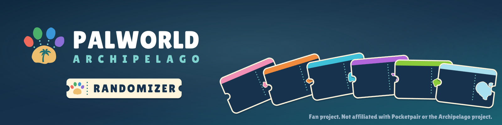
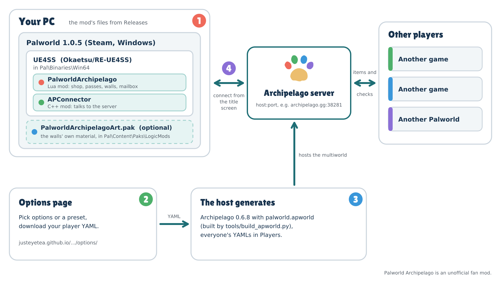
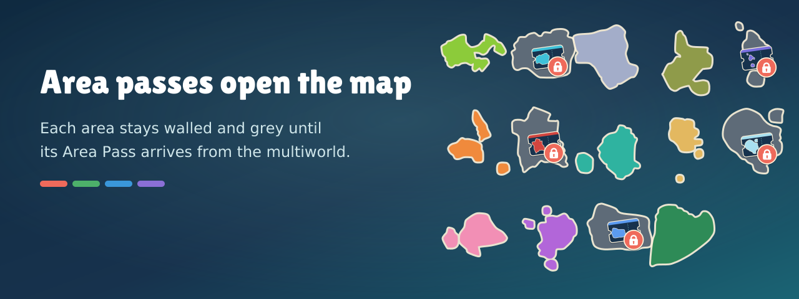
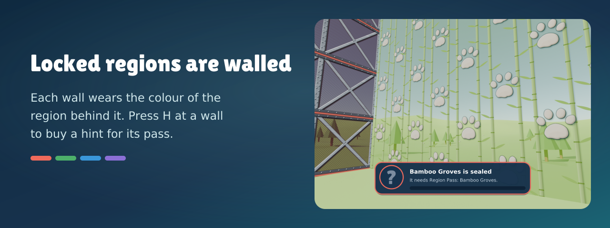

# Palworld Archipelago Randomizer

[Archipelago](https://archipelago.gg) links games from different players into one shared randomizer: items from your
game turn up in theirs, and theirs in yours. In Palworld, the Technology tree becomes a shop whose purchases send
items to other players, and the map opens region by region as passes arrive. Catching Pals, beating alphas and tower
bosses, unlocking fast-travel points and levelling up send items too.

**Made with AI.** Most of the code, tools, documentation and art were written by Claude, an AI model made by
Anthropic, at JustEyeTea's direction; JustEyeTea is reviewing the code by hand, playtests every build and
makes the design calls.

Unofficial fan project: not affiliated with or endorsed by Pocketpair, Inc. or the Archipelago project.

## Status

- Version 0.15.0, in development and being playtested.
- For Palworld 1.0.5 on Steam, for Windows.
- Generating a game needs Archipelago 0.6.8 or newer.
- Single-player worlds only: each player in the multiworld plays their own world. Co-op and dedicated servers are
  not supported.
- Some parts are not tested in game yet. The setup guide lists them:
  [Not tested in game yet](apworld/palworld/docs/setup_en.md#not-tested-in-game-yet).

## Get started

No release yet: the first is coming soon.

- **Download**: [Releases](https://github.com/JustEyeTea/Palworld-Archipelago-Randomizer/releases).
- **Install and connect**: the [setup guide](apworld/palworld/docs/setup_en.md).
- **Make your YAML**: the [options page](https://justeyetea.github.io/Palworld-Archipelago-Randomizer/options/).
- **How the game plays**: goals, presets, checks and options, in
  [the game page](apworld/palworld/docs/en_Palworld.md).
- **The project's site**: https://justeyetea.github.io/Palworld-Archipelago-Randomizer/

<picture>
  <source srcset="docs/install-diagram-dark.svg" media="(prefers-color-scheme: dark)">
  
</picture>

The wall above wears one of the walls' looks. By default, with the art pak, each region's walls show the region's
own design over its colour.

## Help and bug reports

Open an issue on [GitHub Issues](https://github.com/JustEyeTea/Palworld-Archipelago-Randomizer/issues). Please
include:

- `UE4SS.log` (in `Pal\Binaries\Win64\ue4ss`), attached as a file. Remove your password if you paste parts of it.
- The line `[PalworldAP] loaded <version>` from that log, which says which mod version you run.
- The seed (or the room's link) you were playing.

## For developers

What is where:

- `apworld/palworld/`: the APWorld (options, items, locations and logic). `game_data.py` is generated from the game's
  tables by `tools/gen_apworld_data.py`.
- `mod/PalworldArchipelago/`: the UE4SS Lua mod. Its `Scripts/ap_data.lua` is generated from the APWorld by
  `tools/gen_lua_data.py`. `mod/test/` is its test harness (`tools/lua_harness.sh`).
- `cppmod/APConnector/`: the UE4SS C++ mod that connects to the Archipelago server. CI builds it on Windows and
  packages it with the Lua mod.
- `logicmod/`: the optional Blueprint paks built in the community Palworld Modding Kit (the art pak, and a mailbox
  window not released yet).
- `tools/`: the generators, test scripts and the server-side probe that dumps the game's tables.
- `data/`: the facts the randomizer needs from the game (regions, areas, level tiers, where each Pal can be found).
- `art/`: the logo, icons and pictures. `docs/`: the developer guides and the
  project's site (the landing page and the options page).

Raw dumps of Pocketpair's game tables are not distributed here: they are Pocketpair's, not covered by this
repository's licence, and are regenerated from your own copy of the game with the probe's `dumptable` and
`dumpactors` commands.

Where to read next:

- [docs/architecture.md](docs/architecture.md): what each part does, which file owns what, and where to look when
  something breaks.
- [docs/style-guide.md](docs/style-guide.md): the rules the code follows.
- [CONTRIBUTING.md](CONTRIBUTING.md): how to work on the project.
- [CHANGELOG.md](CHANGELOG.md): what changed in each release.
- [tools/README.md](tools/README.md), [logicmod/README.md](logicmod/README.md) and
  [mod/PERF-PROBE.md](mod/PERF-PROBE.md) (the test builds' performance probe, `perf_log=1`).

### The options page

`docs/options/` is the [options page](https://justeyetea.github.io/Palworld-Archipelago-Randomizer/options/), where a
player picks options (or a preset) and downloads a player YAML. Archipelago's website only has options pages for the
worlds it ships, so this world has its own. The YAML it writes is the one Archipelago's template generator writes for
the same choices.

- The YAML names the world's version, so the host's `.apworld` must be built with `tools/build_apworld.py`, which
  adds the manifest fields Archipelago reads the version from. A plain zip of `apworld/palworld` loads as version
  0.0.0, and Archipelago refuses the page's YAMLs.

      AP_DIR=../archipelago-0.6.8 ../archipelago-0.6.8/.venv/bin/python tools/build_apworld.py palworld.apworld

- The page reads `docs/options/options.json`, written from the APWorld's options, groups and presets. After changing
  `apworld/palworld/options.py` or the world version, regenerate it:

      AP_DIR=../archipelago-0.6.8 ../archipelago-0.6.8/.venv/bin/python tools/gen_options_page.py

- `tools/test_options_page.py` checks that `options.json` is current, that the page's YAML for the defaults and
  each preset matches Archipelago's own templates, and that each one generates a beatable seed (its docstring has
  the command).
- To try the page locally, run `python3 -m http.server -d docs` and open http://localhost:8000/options/.

## Licence, credits and trademarks

CC0 1.0 Universal (see LICENSE). The artwork in `art/` (the logo and the shop card icons) is CC0 too and was made by
Claude (Opus 5.5) at JustEyeTea's direction. The wordmark's letters are outlines of the Lilita One typeface by Juan
Montoreano, under the SIL Open Font License 1.1 (`art/FONT-LICENSE-LilitaOne-OFL.txt`); the options page ships the
font file itself (`docs/options/LilitaOne-Regular.ttf`, with its licence in `docs/options/LilitaOne-OFL.txt`). The
README graphics (`art/readme/` and the install diagram in `docs/`) and the site's pages, styling and pictures
were made by Claude (Opus 5.5) too.

Palworld Archipelago Randomizer is an unofficial fan project. It is not affiliated with or endorsed by Pocketpair,
Inc. or the Archipelago project. Palworld is a trademark of Pocketpair, Inc.
