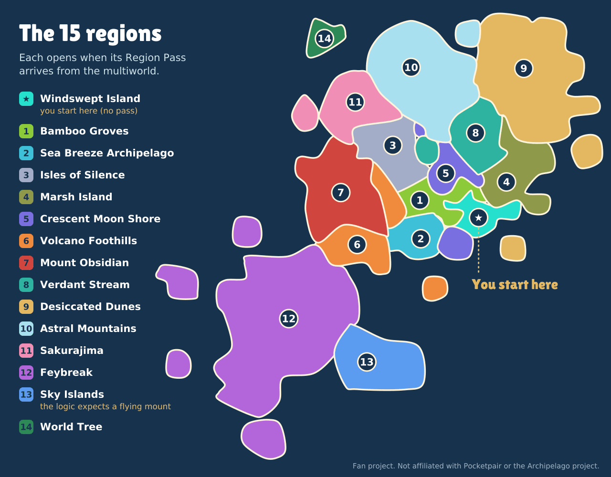
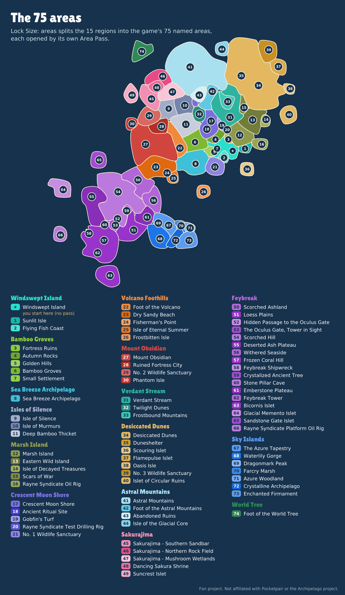
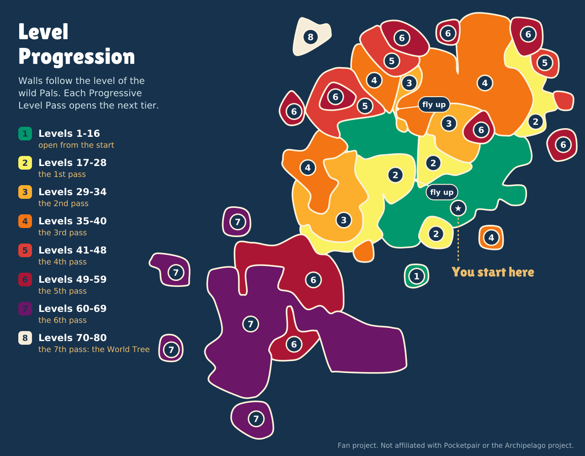
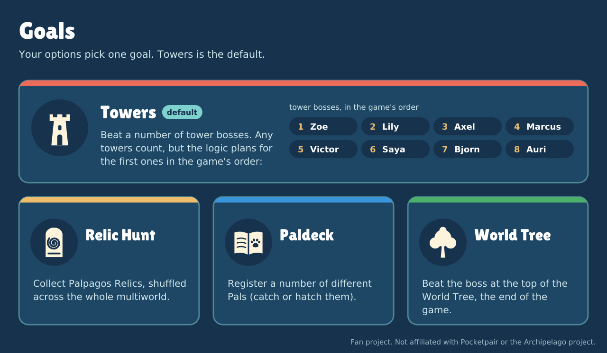
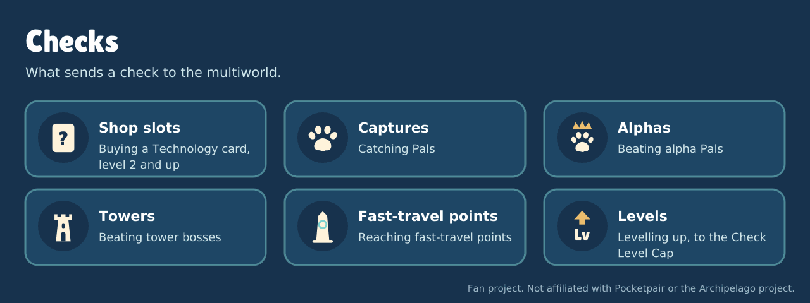
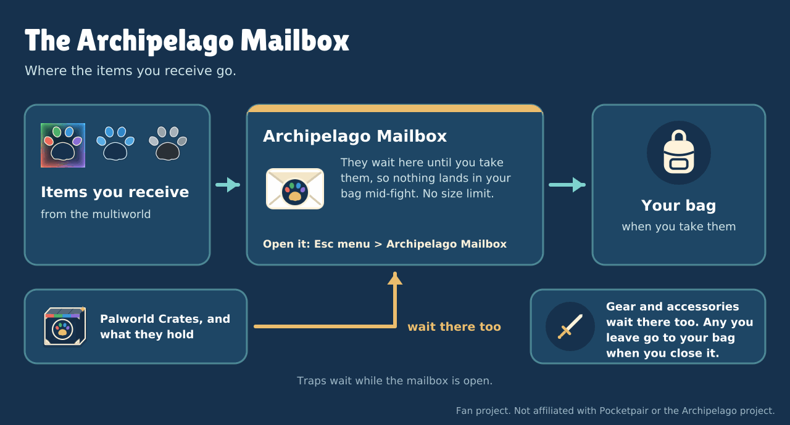
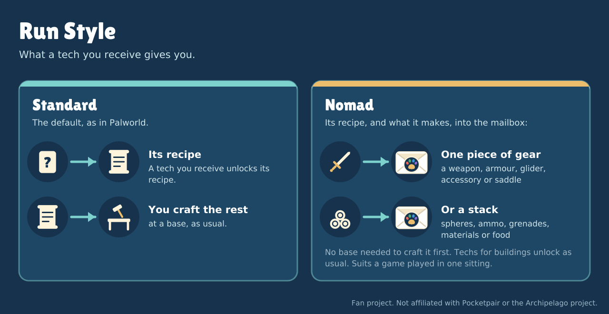

# Palworld

Palworld's Technology tree (levels 2 and up) becomes a shop: each card shows what buying it sends to the multiworld,
and every tech is an item that arrives from Archipelago. The map is locked, and opens as passes arrive. Captures,
alphas, fast-travel points, levels and towers are further checks.

To install the mod and connect, see the setup guide. Some parts are not tested in game yet: the setup guide's
"Not tested in game yet" section is the one list of them.

## Presets

Ready-made sets of options, on the options page and in the Launcher's template. The check counts are approximate
(with Lock Size: regions; areas comes within a few). A typical Archipelago game has about 180.

| Preset | Goal | Checks |
|---|---|---|
| Short Sync | 1 tower, level checks every 5 (5, 10, 15), no fast-travel checks | ~180 |
| Sync | 1 tower | ~240 |
| Long Sync | 2 towers | ~390 |
| Nomad Sync | 2 towers, Run Style: Nomad | ~390 |
| Relic Hunt Sync | 15 of 20 relics, checks up to level 25 | ~355 |
| Paldeck Sync | 60 Pals | ~250 |
| Async | 3 towers | ~585 |
| Full Game Async | World Tree | ~1,150 |
| No preset (the defaults) | 2 towers | ~390 |

Every Sync preset turns on Speed Boost (below). Nomad Sync is Long Sync with Run Style: Nomad, which changes what
a tech gives you, not which checks there are, so its count is the same. The defaults are Long Sync without Speed
Boost.

## The map

With Area Locks on (the default), the map beyond the start is locked. Lock Size sets how it is cut:

- **Regions** (the default): 15 regions, each opened by its Region Pass. You start in Windswept Island and its two
  nearby isles.
- **Areas**: the game's 75 named areas, each opened by its Area Pass. You start in the Windswept Island area alone.
- **Levels** (Level Progression): 8 tiers of wild Pal level. The first tier is open from the start, and each of the
  7 Progressive Level Passes opens the next one, in order.

A locked part is walled off, and the world map shows it greyed under its colour, with a locked stamp. A part that
has opened is lightly tinted, with an open stamp until you go there. A part beyond your goal is dark grey. The open
sea is always free.

### Level Progression

With Lock Size: levels, the walls follow where wild Pals of each level live, not the game's named places. The tiers
are levels 1-16 (the start, Windswept Island among it), 17-28, 29-34, 35-40, 41-48, 49-59, 60-69 and 70-80 (the World
Tree). A tier can lie in several places.

Three places need a flying mount besides their passes:

- the Sky Islands;
- a levels 29-34 valley in the Astral Mountains that higher tiers surround, reached by flying up a walled corridor;
- the low Isles of Silence, levels 1-16 but ringed by the 17-28 tier, reached by a walled corridor from the start
  (the Nitewing Saddle is a level 15 tech, and Nitewing live near the start).

A wing icon on the map marks where each corridor starts, until you have flown through it. A corridor only gets you
through: the Pals and statues in it count for the tier around it.

## Goals

- **Towers** (the default): beat a number of tower bosses. Any towers count, but the logic plans for the first ones in
  the game's order: Zoe (level 10), Lily (20), Axel (30), Marcus (40), Victor (50), Saya (55), Bjorn (60), Auri (68).
- **Relic Hunt**: collect Palpagos Relics, shuffled across the whole multiworld.
- **Paldeck**: register a number of different Pals (catch or hatch them).
- **World Tree**: beat the boss at the top of the World Tree, the end of the game.

## How many checks

### What sends a check

- **Shop slots**: buying a tech card in the Technology tree. By default the décor techs (furniture, flag and foliage
  sets, statues, signs and lights) stay normal research, bought with tech points as usual; the Tech Checks option can
  make them checks too.
- **Captures**: the first capture of each Pal that can be caught.
- **Alphas**: beating each field alpha.
- **Towers**: beating each tower boss.
- **Fast-travel points**: unlocking each one.
- **Levels**: reaching player levels (every level, every 5, every 10, or none).

### The Check Level Cap

Checks stop at a level that fits the goal (the Check Level Cap, automatic by default):

- Towers: 8 levels past the last tower boss you need (18 for one tower, 28 for two).
- Paldeck: 5 levels past the level by which you can register enough Pals.
- Relic Hunt: 30.
- World Tree: no limit.

Shop slots for techs above the cap stay normal research.

### Parts beyond the goal

With Area Locks on, a short goal keeps a small map: regions whose Pals are all above the cap have no pass and no
checks, and their walls stay up (Regions Beyond the Goal: locked, the default). A two-tower game has passes for the
regions up to level 28 only. Regions Beyond the Goal can instead open them from the start (still with no checks in
them), or keep a pass for every region. With Lock Size: areas, the same goes for areas. With Lock Size: levels, a tier
the goal needs keeps every tier below it, since each pass opens the next one.

## What the logic expects

Levels climb region by region: a region counts for levelling once it is open and you are no more than 8 levels below
its Pals. Nothing stops you levelling; the logic just won't expect a level-20 boss or a level-23 Pal before your open
regions let you reach that level.

By default (Gear Logic off) only passes and levels decide where things can be. Your first Pal Sphere comes early,
and gear never holds up progression: better spheres, furnaces, prerequisites, the Pal Labor Research Lab and breeding
are ordinary items. Tech cards that need another tech or Lab research first stay normal research, bred-only Pals
aren't checks, and parts of the map only the open sea reaches have no checks. A saddle counts only where the map needs
one: a flying mount for the Sky Islands, and a swimming or flying one when the goal lies across the open sea.

With Gear Logic on, the logic also asks for spheres good enough for each Pal's level (and the furnace their recipe
needs), every tech's prerequisites, the Lab, breeding, and a mount for the open sea.

**Progressive Spheres** (off by default): the sphere techs arrive in order (Pal Sphere, then Mega, Giga and so on)
instead of separately.

**Tech points.** Shop slots cost their usual tech points, which the logic doesn't count. So only the slots levelling
pays for in time can hold anyone's progression or useful items: 6 points a level, the cheapest first as they open,
and Ancient slots within the Ancient points of the towers you beat before the goal. The rest hold filler and traps.
Long goals ask for more points than levelling gives: fast-travel points and Technical Manuals (from dungeons,
treasure chests and the Bounty shop) make up the rest.

## Filler items and the mailbox

Filler items are Palworld Crates by default: each is a Sphere, Food, Common, Rare or Jackpot crate (the Crate Chance
options), opened when you like from the mailbox or the Inventory page, with contents for your level then. The Material
Bundles option adds Wood, Stone, Paldium, Ingot, Sphere and Food bundles, and the Tech Point Items option adds Tech
Points +2 and Ancient Tech Points +1. Turn the Palworld Crates option off for no crates: the other filler takes their
place (tech points when both of those options are off).

Items you receive (material bundles, what a crate holds, a Nomad tech's gifts) wait in your Archipelago Mailbox until
you take them, so nothing lands in your bag mid-fight. Open it from the Esc menu's Archipelago Mailbox button, or from
the one at the right of your name on the Inventory page; it has no size limit. Gear and accessories show in the
mailbox too: any you leave there go to your bag when you close it, and chat says when the game puts a piece straight
onto you.

## Run Style

What a tech you receive gives you:

- **Standard** (the default): its recipe, as in Palworld; you craft the rest at a base.
- **Nomad**: its recipe, and what it makes, so you don't need a base that can craft it first: a weapon, armour,
  glider, accessory or saddle (one), or a stack of spheres, ammo, grenades, materials or food, all waiting in your
  Archipelago Mailbox. Techs for buildings unlock as usual. Suits a game played in one sitting.

## Speed Boost and World Settings

By default the mod never changes your world's settings: you set them yourself in World Settings. For a game played
over days the game's own settings are fine. For one played in one sitting (Sync), these are good places to start:

| World setting | Palworld's Normal | Palworld's Easy | Suggested for Async | Suggested for Sync |
|---|---|---|---|---|
| EXP Rate | 1 | 1.3 | 1.5–2 | 2–3 |
| Pal Capture Rate | 1 | 2 | 1–2 | 2 |
| Gatherable Items Multiplier | 1 | 2 | 1–2 | 2 |
| Dropped Items Multiplier | 1 | 2 | 1–2 | 2 |
| Time to hatch a massive egg | 1 | 0.5 | 0.5 | 0.5 |
| Work Speed Multiplier | 1 | 1 | as you like | as high as it goes |
| Max Pals at base | 15 | 15 | more if you like | more if you like |
| Structure Deterioration Rate | 1 | 1 | 0 (off) | 0 (off) |

Structure Deterioration Rate 0 stops buildings outside a base (bridges, ladders, outposts) from slowly wearing
away, which suits a run that sends you all over the map. Speed Boost never changes it.

**Speed Boost** (off by default; the Sync presets turn it on) does some of this for you: the mod multiplies your
world's EXP Rate, Work Speed Multiplier and Gatherable Items Multiplier (×3, ×3 and ×2 by default; set each in the
YAML), on top of whatever you set yourself.

**It changes your world's own settings, and your world keeps them in its save, also after the game.** When you
connect, the mod tells you in game what it changed and your world's own values. It keeps those values in its own save,
so loading the world again never multiplies twice. Set them back in World Settings to play the world on without it,
and before starting another seed in the same world: a new seed takes the values the world holds as its own, so a world
still sped up by the last seed is sped up again.

## Traps

Off by default. Trap Chance replaces that share of the filler items (crates, material bundles and tech points) with
traps, picked by the trap weights. None of them can make you faint:

- **Slow Trap**: half walking speed for a minute.
- **Hunger Trap**: your stomach loses half a full meter of satiety, but never drops below a quarter (so it never
  starts starving damage).
- **Teleport Trap**: back to the starting region (or area, or first tier). It waits while you are in a dungeon.
- **Fool Trap**: an alarming notice, then "just kidding" a few seconds later. Nothing happens.

Traps go off as they arrive, and wait while you are fainted, while the world is loading and while the mailbox is
open. At most 10 wait at a time: past that the oldest are skipped, and chat says how many. A Slow Trap shows a snail
icon with its time left at the top of the screen. A chat line names each trap and who sent it. If a trap can't do its
job, chat says "<trap> fizzled" and nothing else happens.

## Death Link

With Death Link on, fainting sends a death to everyone linked, and a death from them faints you like any other
faint: you drop what your world's Death Penalty setting says. Death Link Amnesty forgives that many of your own
faints before one is sent: with 2, every third faint is sent. Chat says when a faint is forgiven and how many are
left. The count is kept with the seed's save, so quitting doesn't reset it. Deaths other players send you never count.

Most of the code, tools, documentation and art were written by Claude, an AI model made by Anthropic, at JustEyeTea's
direction; JustEyeTea is reviewing the code by hand, playtests every build and
makes the design calls.
