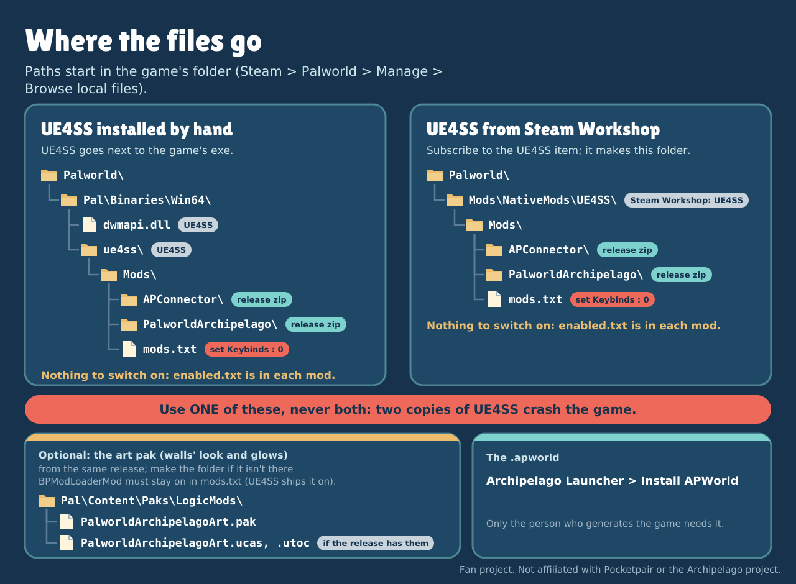

# Palworld Setup Guide

Palworld Archipelago Randomizer is a mod for Palworld 1.0.5 on Steam for Windows. It runs inside your own game
through UE4SS: a Lua mod (PalworldArchipelago) plus a small C++ mod (APConnector) that talks to the Archipelago
server. It is new and still being playtested, so some parts are not tested in game yet: they are listed at the end
of this guide, under [Not tested in game yet](#not-tested-in-game-yet).

Most of the code, tools, documentation and art were written by Claude, an AI model made by Anthropic, at JustEyeTea's
direction; JustEyeTea playtests every build and makes the design calls.

## 1. Before you start

What you need:

- **Palworld 1.0.5** on Steam, for Windows.
- **UE4SS for Palworld**: Okaetsu's build, from
  [its release page](https://github.com/Okaetsu/RE-UE4SS/releases/tag/2281fa31). Take the file `UE4SS-Palworld.zip`,
  not the one whose name ends in `_zDev`.
- **The mod**, `PalworldArchipelago-v<version>.zip`, from the
  [Releases](https://github.com/JustEyeTea/Palworld-Archipelago-Randomizer/releases) page. It holds the folders
  `ue4ss\Mods\APConnector` and `ue4ss\Mods\PalworldArchipelago`.
- **Optional: the art pak**, `PalworldArchipelagoArt.pak`, from the same release. It gives the walls their own look
  (each region's own wall, a glow near you, a dissolve when a region opens) and adds the glows round statues and new
  items. An early release may not have it yet. Without it the walls wear the game's own wall material in your
  regions' colours, and there are no glows.
- **Archipelago 0.6.8 or newer**, only for whoever generates the multiworld.

Not supported:

- Xbox, Game Pass and the Microsoft Store version of Palworld.
- Co-op (friends joining your world) and dedicated servers.

Steam Deck and Proton are not tested. Each player in the multiworld plays their own single-player world.

## 2. Install

1. Find the game's folder: in Steam, right-click Palworld > Manage > Browse local files. It is usually
   `C:\Program Files (x86)\Steam\steamapps\common\Palworld`. The paths below start there.
2. Install UE4SS in **one** of these two ways, never both: two copies of UE4SS crash the game.
   - **By hand** (the way this guide is tested): unzip `UE4SS-Palworld.zip` into `Pal\Binaries\Win64`, as its own
     instructions say. You now have a folder `Pal\Binaries\Win64\ue4ss`.
   - **From the Steam Workshop**: subscribe to the "UE4SS Experimental (Palworld)" item. It lives in
     `Mods\NativeMods\UE4SS`. Use that folder wherever these steps say `Pal\Binaries\Win64\ue4ss`. This way is not
     tested with the mod yet.
3. Start the game once, then quit. Check that `Pal\Binaries\Win64\ue4ss\UE4SS.log` is there now. If it isn't, UE4SS
   is not installed right: fix that first.
4. Copy the `ue4ss` folder from the mod's zip over `Pal\Binaries\Win64\ue4ss`. You now have the folders
   `ue4ss\Mods\APConnector` and `ue4ss\Mods\PalworldArchipelago`. (Workshop UE4SS: copy the two folders from the zip's
   `ue4ss\Mods` into `Mods\NativeMods\UE4SS\Mods`.) There is nothing to switch on: each folder holds an `enabled.txt`,
   so UE4SS starts it.
5. Open `ue4ss\Mods\mods.txt` in a text editor and change the line `Keybinds : 1` to `Keybinds : 0`. Then save it.
   This prevents a crash: UE4SS's Keybinds mod dumps the game's files on Ctrl+H, and pressing the hint key (H) while
   crouching (Ctrl) sets it off. The mod warns in chat while Keybinds is on.
6. Optional: copy `PalworldArchipelagoArt.pak` into `Pal\Content\Paks\LogicMods` (make the folder if it isn't there).
   If the release also has `PalworldArchipelagoArt.ucas` and `PalworldArchipelagoArt.utoc`, copy them there too. The
   line `BPModLoaderMod : 1` in `mods.txt` must stay as it is: UE4SS needs it to load the pak.

## 3. Make your YAML and the game

1. Make your player YAML on the [options page](https://justeyetea.github.io/Palworld-Archipelago-Randomizer/options/)
   (or from the Archipelago Launcher's template once `palworld.apworld` is installed).
2. Send your YAML to whoever generates the multiworld. Your YAML must match the version of their `palworld.apworld`:
   use the `palworld.apworld` from the same release as your mod.

For whoever generates: archipelago.gg can't generate a Palworld game itself, because Palworld is not one of the games
Archipelago ships.

1. Install Archipelago 0.6.8 or newer.
2. Install `palworld.apworld`: double-click it, or copy it into Archipelago's `custom_worlds` folder.
3. Put every player's YAML into Archipelago's `Players` folder.
4. Run **Generate** in the Archipelago Launcher. The game is written to Archipelago's `output` folder as a `.zip`.
5. To host it, upload that `.zip` on [archipelago.gg](https://archipelago.gg) (Host Game), or run it with your own
   Archipelago server.

## 4. Connect

1. Start Palworld. On the title screen, before you load a world, click the **Archipelago banner** above the menu. The
   title's buttons make way for the Archipelago menu.
2. Fill in the fields:
   - **Server**: the room's host, such as `archipelago.gg`. You can paste the whole address (`host:port`): the port
     moves to its own box. While you type here, archipelago.gg and every server you have connected to before show
     under the box: click one to use it.
   - **Port**: the number after the colon in your room's address (`archipelago.gg:38281` has port 38281).
   - **Slot**: your slot name, as in your YAML.
   - **Password**: the room's password. Leave it empty if there is none.
3. Click the row that says **Connect to &lt;server&gt; as &lt;slot&gt;**. Once connected, the menu folds away and the
   banner says **Connected**, with the server and your slot. While connected, the same row says **Disconnect**.
   **Back** (or Esc) closes the menu without connecting.
4. Make a **new world** for this game, and load it.

If the boxes can't be typed in, the menu shows plain rows instead: click **Server** to step through your saved
servers, or **Type a server address...** to type one. Port, Slot and Password each open a box to type in.

The mod remembers the server, slot and password in `ue4ss\Mods\PalworldArchipelago\config.txt`, and connects by
itself the next time you start the game.

**One world per game.** A game belongs to the first world you play it in. If that world already has research done,
the mod asks first: chat says "This world already has progress" and how many techs would be locked again. Load a new
world, or press **H** to play the game in that world anyway. In any other world the mod connects but does nothing,
and chat says:

> This is not the world this Archipelago seed is played in: nothing is locked, sent or given here.

To move a game to another world, delete the `world=` line from its `save-<seed>-<slot>.txt` in the
`ue4ss\Mods\PalworldArchipelago` folder, then load the other world.

## 5. Playing

- **The shop.** The Technology tree (levels 2 and up) is the shop. Each card shows what buying it sends, and buying
  spends the usual tech points. A tech itself unlocks only when its item arrives. In a new world nothing can be
  bought until you connect.
- **Buying while disconnected.** If the connection drops while you play, you can keep buying: the check is sent when
  the connection is back. You can also start without connecting, in the world you play the game in: purchases are
  kept and sent the next time you connect. (Not tested in game yet.)
- **The Archipelago Mailbox.** Items you receive wait in the mailbox until you take them, so nothing lands in your
  bag mid-fight. So does what you get from opening a Palworld Crate or from a Nomad tech. Open it from the Esc menu
  (Archipelago Mailbox), or from the button at the right of your name on the Inventory page.
- **Gear in the mailbox.** Gear and accessories show in the mailbox too: take them out as usual. Any you leave there
  go to your bag when you close the mailbox. If the game puts a piece straight onto you (an empty equipment slot),
  chat says it is now equipped. With a full bag, gear waits in the mailbox until you open it again. (Gear showing in
  the mailbox is not tested in game yet.)
- **Walls.** With Area Locks on, each locked region is walled off until its Region Pass arrives. (With Lock Size:
  areas it is each of the game's 75 areas and its Area Pass; with Lock Size: levels, each tier of Pal level, opened in
  order by Progressive Level Passes.) A wall wears its region's colour. With the art pak it shows the region's own
  wall, and a bunker grille on a region beyond your goal, which stays closed for good. Without the pak it is a
  coloured wall with paw-shaped holes, grey beyond your goal.
- **The map.** On the world map, each region is tinted in its colour by its state. A locked one is greyed, with a
  locked stamp. An open one you haven't been to yet is lightly tinted, with an open stamp. One you have been to shows
  only its edge. One beyond your goal is dark grey. The standing walls glow on the map. (`map_style=chart` in
  `config.txt` shows an explorer's chart instead.)
- **Hints.** At a locked wall, chat names the pass it needs. Press **H** to buy a hint for that pass: it costs your
  Archipelago hint points, as `!hint` does, and the hint says where the pass is. Chat tells you if you don't have
  enough points.
- **Locked regions.** If you end up inside a locked region (you loaded there, or got past a wall), you are sent back
  to the starting region (with Lock Size: areas, the starting area; with levels, the first tier) after a moment.
  Chat says which one was locked.
- **Mounts.** The logic expects a mount that swims or flies to cross the open sea, and a flying one to reach the Sky
  Islands. With Lock Size: levels, you also fly up walled corridors to the Astral Mountains valley and the Isles of
  Silence. A wing icon on the map marks where each corridor starts, until you have flown through it. A corridor only
  gets you through: the Pals and statues inside it count for the tier around it.
- **Glows.** With the art pak, a halo and a tall pillar of light mark the fast-travel statues near you that are still
  checks, and a burst of light round you marks each new item (its colour says progression, useful or filler). `glow=0`
  in `config.txt` turns them off.
- **The goal.** When you reach your goal (and are out of the boss's arena), a banner and a chat line say
  "Goal complete".

## 6. Keys and settings

- **H**: buy a hint at a wall, and say yes when the mod asks about a world with progress. Change it with `hint_key`.
- **Esc**: closes the Archipelago menu on the title screen.
- No key opens the mailbox unless you set one with `mailbox_key`.

The settings are in `ue4ss\Mods\PalworldArchipelago\config.txt` (copy `config.example.txt` to make it, or connect
once from the title screen). Lines a player might want:

| Line | What it does |
|---|---|
| `hint_key=H` | The hint key: a letter or a key name such as `F6`. |
| `mailbox_key=` | A key that opens the mailbox (empty: only the menu buttons). |
| `glow=0` | No glows. |
| `wall_radius=75` | How near (in metres) walls are drawn; `0` draws them all, which costs frame rate. |
| `map_style=chart` | The world map as an explorer's chart instead of the tinted regions. |

The other lines in `config.example.txt` are for testing. Two things to know:

- Your **password is stored as plain text** in `config.txt`.
- `test_tools=1` turns on cheats meant for testing (free EXP, faster walking, traps on a key). Don't use it in a real
  game.

## 7. Updating and uninstalling

To update:

1. In `ue4ss\Mods\PalworldArchipelago`, keep `config.txt`, every `save-*.txt`, `worlds.txt` and `research.txt`.
   In `ue4ss\Mods\APConnector`, keep `client_uuid.txt`.
2. Delete everything else in those two folders.
3. Copy in the two folders from the new release's zip, as in [Install](#2-install) step 4.
4. If the release has a new art pak, copy it over the old one.

Use the `palworld.apworld` from the same release as your mod. If the game you join was made with a newer
`palworld.apworld` than your mod, chat may say "This seed's Lock Size (...) is newer than this mod": update the mod.

To switch the mod off for a while, delete the `enabled.txt` in both folders (and any lines for them in `mods.txt`).
To remove it, delete the two folders and `Pal\Content\Paks\LogicMods\PalworldArchipelagoArt.pak` (with its `.ucas`
and `.utoc`, if you copied them).

What a world keeps after a game:

- Techs whose item never arrived are not researched. Without the mod you can research them as usual.
- Tech points spent on shop slots don't come back.
- Speed Boost's world settings stay in the world's save: set them back in World Settings.

Use a new world for each new game.

## 8. Troubleshooting

The log is `Pal\Binaries\Win64\ue4ss\UE4SS.log` (Workshop UE4SS: `Mods\NativeMods\UE4SS\UE4SS.log`). The mod's lines
start with `[PalworldAP]`, and the connector's with `[APConnector]`.

- **Is the mod loaded?** Look for the line `[PalworldAP] loaded <version>`. No such line: the `PalworldArchipelago`
  folder is not in the right place, or UE4SS is not running.
- **`APConnector is not installed`**: the `APConnector` folder is missing or in the wrong place. Copy it in again
  (Install step 4). Without it the mod stays off.
- **A chat warning about UE4SS's Keybinds mod**: set `Keybinds : 0` in `mods.txt` (Install step 5). If it still
  warns, delete `ue4ss\Mods\Keybinds\enabled.txt`, if there is one.
- **"This seed's Lock Size ... is newer than this mod"**: the game was made with a newer `palworld.apworld`. Update
  the mod to the same release.
- **Nothing happens in this world**: it is not the world the game is played in (see [Connect](#4-connect)).

To report a problem, open an issue on
[GitHub Issues](https://github.com/JustEyeTea/Palworld-Archipelago-Randomizer/issues). Attach `UE4SS.log` and say
which game (seed) it was. Remove your password from anything you paste.

## Not tested in game yet

These parts are written and pass the automatic tests, but nobody has played them in the game yet. They are tested
(or cut) before the first release.

- The **World Tree** goal.
- **Alpha checks.** If beating an alpha sends nothing (the log says `alpha record key not mapped`), turn Alpha
  Checks off for your next game.
- **Level Progression** (Lock Size: levels): a whole game played through; flying up a corridor; the fast-travel point
  in the Isles of Silence corridor counting for levels 17-28; hints for Progressive Level Passes.
- **Buying while disconnected**, starting the game without connecting, and the connection coming back by itself
  while you play.
- **Gear shown in the mailbox** (gear handed to your bag from the mailbox works).
- **The Inventory page's mailbox button** (the Esc menu's button works).
- **A full bag** when you take items out of the mailbox.
- **UE4SS from the Steam Workshop.**
- **A controller** on the mod's menus and buttons.
- **A Slow Trap while riding** a mount.
- **Death Link Amnesty** (Death Link itself works).

Co-op, dedicated servers and the Microsoft Store version are not supported.
