# Architecture

How the Palworld Archipelago Randomizer is put together: what each part does, which file owns what, and where to look
when something breaks. It is for anyone who maintains or changes the code. Players need only the
[setup guide](../apworld/palworld/docs/setup_en.md); contributors start with [CONTRIBUTING.md](../CONTRIBUTING.md).

Most of this code was written by Claude, an AI model made by Anthropic, at JustEyeTea's direction. This guide is here
so that the project's maintainer, or anyone else, can know every file well enough to fix it by hand.

This guide names files, functions and tables, not line numbers, so it stays true as the code moves. Change it in the
same pull request as the code it describes. The rules for writing the code itself are in the
[style guide](style-guide.md).

## Contents

1. [Overview](#overview)
2. [Words](#words)
3. [Repository map](#repository-map)
4. [Generated files](#generated-files)
5. [The APWorld](#the-apworld)
6. [The APConnector (C++)](#the-apconnector-c)
7. [The Lua mod](#the-lua-mod)
8. [The LogicMod paks](#the-logicmod-paks)
9. [Tests, tools, CI and releases](#tests-tools-ci-and-releases)
10. [Where to look when something breaks](#where-to-look-when-something-breaks)

## Overview

The project has four parts:

| Part | Where | Runs | Job |
|---|---|---|---|
| **APWorld** | `apworld/palworld/` | Python, in Archipelago, when a multiworld is generated | Defines the items, the locations (checks) and the logic of what is reachable when. Its output is the seed. |
| **APConnector** | `cppmod/APConnector/` | C++ DLL, a UE4SS mod in the player's game | Talks to the Archipelago server on its own thread. Gives the Lua mod `AP_*` functions (`AP_Connect`, `AP_Poll`, `AP_Check`, `AP_Goal`, `AP_GivePal`, image and map helpers). The full list is at the top of `dllmain.cpp`. |
| **Lua mod** | `mod/PalworldArchipelago/Scripts/` | Lua, a UE4SS mod in the player's game | The game-side brain. Every 300 ms it collects server events (`AP_Poll`), acts on received items, reads the player's records and sends finished checks (`AP_Check`). |
| **LogicMod paks** | `logicmod/` | Unreal assets, built in the Palworld Modding Kit | Assets Lua cannot make: the walls' material and the glows (the Art pak), and the mailbox's own window (the UI pak). |

Under them is a layer of **generated files**: scripts in `tools/` read Palworld's own tables and map and write the
data the other parts use (see [Generated files](#generated-files)).

How the parts meet: the APWorld runs once, when the multiworld is generated; the APConnector and the Lua mod run in
the player's game for the whole session; the tools run only when the game's data changes.

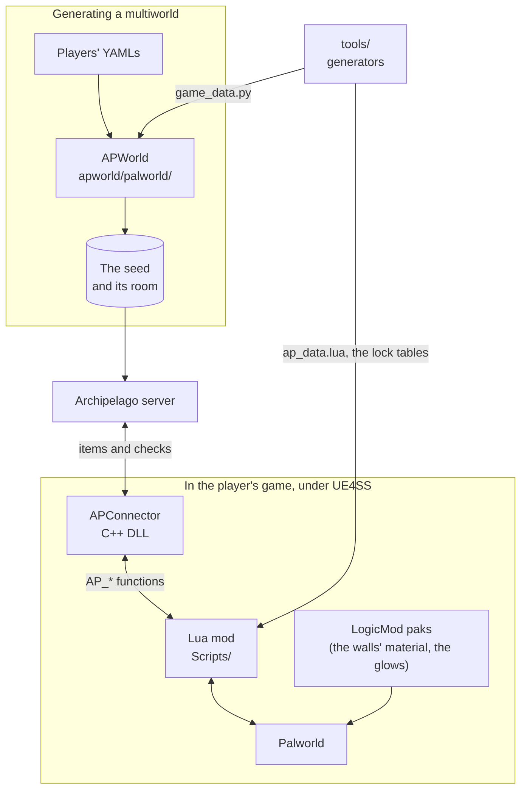

### What happens in a game

1. **Generate.** The player's YAML goes through the APWorld, and Archipelago produces a multiworld and its room.
2. **Start Palworld.** UE4SS loads the APConnector, then the Lua mod (`main.lua`).
3. **Connect.** The title screen's Archipelago menu (`menu.lua`) takes the server, slot and password and calls
   `AP_Connect`.
4. **Play.** Each core update (`main.lua`'s `update()`) runs these steps:
   - Received items unlock techs, take walls down (`walls.lua`), wait in the Archipelago Mailbox (`mailbox.lua`) or
     set off traps (`traps.lua`).
   - The player's records (`records.lua`) become location checks.
5. **Save.** The mod keeps a small save of its own for each seed, beside the game's. It holds how many items have
   arrived, the mailbox, the crates and whether the goal banner has shown.

The same steps as messages between the parts (the update's own steps are under [The Lua mod](#the-lua-mod)):

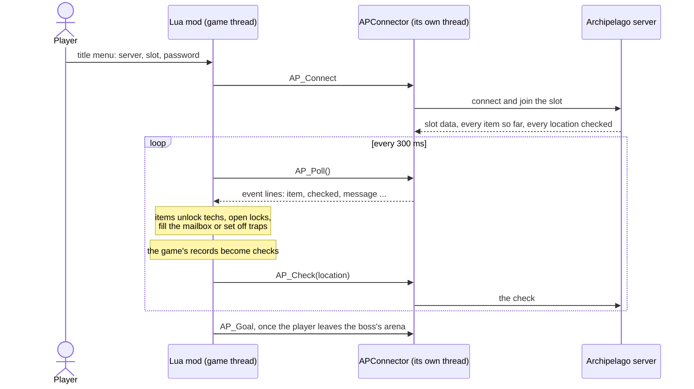

## Words

| Word | Means |
|---|---|
| **Area Locks** | The feature as a whole: the map is walled off in parts, and each part opens when its pass arrives. |
| **Region** | One of the 15 large locked parts (Lock Size: regions, the default), opened by a **Region Pass**. Each is a group of areas. |
| **Area** | One of the game's 75 named places (the game's `DT_WorldMapAreaData`), locked one by one with Lock Size: areas and opened by an **Area Pass**. |
| **Tier** | One of Level Progression's 8 locked parts (Lock Size: levels): the land whose wild Pals by day are in one band of levels (`Levels 1-16` to `Levels 70-80`), wherever it lies. Tiers open in order, each by one more copy of the **Progressive Level Pass**. `tools/level_tiers.py` labels the land by them. |
| **Lock** | Whichever locked part the seed uses: a region, an area or a tier, by Lock Size. Code that serves every size alike says lock: the APWorld's logic (`every_lock`, `locks_in_scope` and the routes in `map_plan.py`, the rules in `__init__.py`), `locks.lua` and the map's Lua, and the tools that build any size (`tools/lock_*.py`). Code that means one kind only says region, area or tier. |
| **Piece** | The logic's smallest part of the map: an Archipelago `Region` in `__init__.py`. Each piece belongs to one lock. |
| **Archipelago Region** | Archipelago's own class for a node in the logic's map (`BaseClasses.Region`). This code makes one per piece. |
| **The core** | In the Lua mod's comments: `main.lua` and its update loop, with the files split from it (listed under [The Lua mod](#the-lua-mod)), which hand the other modules their state and call them. |
| **Lane** | In comments: one Claude session with one job, such as the Art & Assets lane, which makes the project's art. Most of this code was written by Claude at JustEyeTea's direction. |

## Repository map

| Folder | What is in it |
|---|---|
| `apworld/palworld/` | The APWorld: `__init__.py` (the world and its rules), `levels.py` (the tuning numbers and the level climb), `map_plan.py` (the locks and pieces in the seed), `checks.py` (which checks and items the seed has), `options.py`, `data.py` (items and locations), `game_data.py` (generated), `docs/` (the game page and setup guide), `test/` |
| `cppmod/APConnector/` | The C++ mod: `src/`, `test/` (Linux tests of the parts that need no Unreal), `third_party/` |
| `mod/PalworldArchipelago/` | The Lua mod as installed in the game. Its `Scripts/` folder holds the code and the generated tables. |
| `mod/test/` | The Lua test harness: the mod run against stand-ins for UE4SS, the game and the APConnector. `harness.lua` (the kit and the order the test files run in), `fakes.lua`, `fakes_map.lua` and `fakes_menus.lua` (the stand-ins), `helpers.lua`, and `tests/` (the test groups, a file per topic) |
| `logicmod/` | Python scripts the Modding Kit's editor runs to build the paks |
| `tools/` | Generators, test runners and the server-side probe that dumps the game's tables |
| `data/` | Facts derived from the game: each lock size's pieces, borders and levels (`region-model-1.0.5.json` for the 15 regions, `area-model-1.0.5.json` for the 75 areas, `level-model-1.0.5.json` for the tiers), and where each Pal can be obtained (`region-pal-sources-1.0.5.json`, `area-pal-sources-1.0.5.json`, `level-pal-sources-1.0.5.json`) |
| `docs/` | This guide and the style guide; and the GitHub Pages site: the landing page (`index.html`), `404.html`, the shared style (`site.css`), the icon, logos and link-preview picture, the install diagram, and the options page (`docs/options/`) |
| `art/` | The project's own artwork and the README graphics |

## Generated files

These files start with "Generated by ... do not edit by hand". To change one, change its generator or the generator's
input, then run the generator again. Raw dumps of Pocketpair's tables are not in this repository. Make them from your
own copy of the game with the probe's `dumptable` and `dumpactors` commands (`tools/probe/commands.txt`).

| File | Made by | From |
|---|---|---|
| `apworld/palworld/game_data.py` | `tools/gen_apworld_data.py`, given the game version | the table dumps, and that version's `data/region-model-1.0.5.json`, `data/region-pal-sources-1.0.5.json` and their `area-` and `level-` versions |
| `mod/.../Scripts/ap_data.lua` | `tools/gen_lua_data.py` | the APWorld's own tables (`data.py`), so the mod and the APWorld agree on every id |
| `mod/.../Scripts/region_*.lua`, `area_*.lua`, `level_*.lua`, and `region_labels.png`, `area_labels.png`, `level_labels.png` and `level_flying.png` (the flying corridors, striped on the map) beside them | `tools/lock_walls.py` (with `tools/level_tiers.py` for the tiers, `tools/flying_picture.py` for the corridors), `tools/lock_centres.py` (each run once per size; `LOCK_SIZE=areas` for the 75 areas, `LOCK_SIZE=levels` for the tiers) | the game's world map, its map rows, its spawn points' levels (the tiers) and `tools/lock_groups.py` |
| `mod/.../Scripts/area_regions.lua` | `tools/area_regions.py` | `tools/lock_groups.py` |
| `mod/.../Scripts/wall_region_variants.lua` | `tools/wall_region_variants.py` | `area_walls.lua` and `area_regions.lua` (both in this repository), and the versions of each region's wall in `logicmod/art/walls/` |
| `mod/.../region_field.png`, `area_field.png`, `level_field.png` | `tools/map_fields.py` | the label pictures |
| `data/*-model-1.0.5.json`, `data/*-pal-sources-1.0.5.json` | `tools/lock_model.py` | the table dumps and `lock_walls.py`'s private grid |
| `mod/.../Scripts/tech_icons.lua` | `tools/gen_tech_icons.py` | the table dumps |
| `mod/.../Scripts/tech_gifts.lua` | `tools/gen_tech_gifts.py` | the table dumps |
| `docs/options/options.json` | `tools/gen_options_page.py` | the APWorld's options, groups and presets, each preset's one-line description (`preset_descriptions` in `options.py`) and which options only apply with another's value (the generator's `DEPENDS_ON`) |
| `apworld/palworld/test/frozen_ids.tsv` | `tools/freeze_ids.py` | `data.py` (and the file it replaces: no id may move) |
| `mod/.../art/ap-menu-panel-*.png` | `tools/menu_panel_art.py` | nothing (drawn from numbers) |

The rest of the art is not generated here. The mod's pictures (`mod/.../art/` with its `area-passes/`,
`mod/.../walls/`, `mod/.../icons/`) and the Art pak's (`logicmod/art/`) are drawn by the Art & Assets lane, whose
sources are kept outside this repository, and committed here as finished files. What each one is for is in
`mod/.../art/README.txt`, `mod/.../walls/README.txt`, `logicmod/art/walls/README.txt` and
`logicmod/art/glow/glow-spec.txt`. To change one, replace the file.

The same table as a picture: what feeds what. Boxes with round ends are the generators in `tools/`; the private
inputs on the left come from your own copy of the game and are never in this repository.

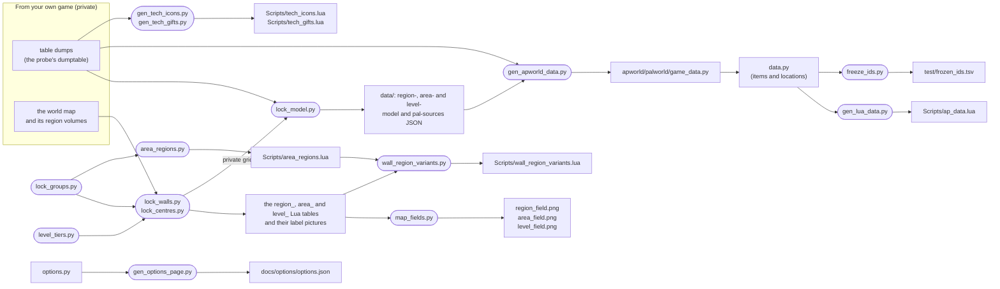

Each generator's private input files are named in [`tools/README.md`](../tools/README.md), with the steps after a
Palworld update, in order ("After a game update"). Each script's exact command is in its own header.

`gen_apworld_data.py` keeps every existing row where it was and adds new rows at the end, so ids never move.

## The APWorld

Archipelago loads `apworld/palworld/` to build a Palworld slot. The files build on each other: `game_data.py` holds the
raw facts, `data.py` turns them into items and locations, and `__init__.py` builds the logic's map (Archipelago
Regions, one per piece) and its rules.

### `data.py`: items and locations

Every item and every location, each with its name and permanent id.

- **Techs.**
  - `SHOP_TECHS` are the techs of level 2 and up; level-1 techs stay vanilla. Each one is both a shop location
    (`shop_location`, named by slot: "Tech Level 12 Slot 3") and an item (`tech_item`: "Tech: Stone Axe").
  - `SPHERE_NEEDS` is what each Pal Sphere needs to craft besides its tech.
  - `SEA_MOUNTS` and `FLYING_MOUNTS` are the saddles that cross the open sea or reach the Sky Islands.
  - `PREREQ_TECHS` are the techs something else depends on, which makes them progression items.
  - `DECOR_TECHS` is the hand-picked décor set for the `tech_checks: no_decor` option.
- **Pals.**
  - `CATCHABLE` holds the Pals that get a capture check: those caught in the wild, as an alpha or in a dungeon
    (`DIRECT`).
  - Pals bred from two such parents also count (`BREEDABLE`).
- **Passes and filler.**
  - Region Pass and Area Pass names (`region_pass`, `area_pass`), and `LEVEL_PASS`, the Progressive Level Pass (one
    item; each copy opens the next tier).
  - `FILLER`, `TRAPS`, `PROGRESSIVE_SPHERE`, `CRATE` (Palworld Crate, the default filler), `RELIC` (the Relic Hunt
    item).
- **`ITEMS` and `LOCATIONS`.** These are made by `_items()` and `_locations()`; each entry is an `ItemDef` or
  `LocationDef`.
- **`LAYOUTS`.** The three ways of cutting the map (the Lock Size option), in one shape (`Layout`) that the logic reads.
  Its keys are Lock Size's values: `regions`, the 15 regions (Region Passes), `areas`, the 75 areas (Area Passes),
  and `levels`, Level Progression's tiers (copies of one Progressive Level Pass: `pass_counts` says how many each tier
  needs, and `in_order` keeps a seed's tiers without a gap). `flying` names the pieces a flying mount reaches: the
  Sky Islands, and with the tiers a piece only higher tiers surround (its walled corridor cut by `level_tiers.py`).
  A corridor holds no checks: `lock_walls.check_pieces` gives its cells' spawn points and objects to the tier
  beneath, and `lock_model.py` places every check by that grid. Its two mouths are in `level_walls.lua`'s
  `corridors`, for the map's fly-up icon (`map_icons.lua`) and the save's `flown` set (`area_locks.lua`).
- **Groups.** `ITEM_GROUPS` and `LOCATION_GROUPS` are the names players can use for hints and `start_inventory`.

A few `assert`s at import time stop generation at once if two items or locations share a name or an id, or a
hand-typed tech id is not in the game's table; each message names the rows that break it.

#### Ids never move

Every id is `BASE` (`0x50A10000`, 1352728576) plus an offset in a fixed block. Old seeds, trackers and other players'
clients keep working after a game update because a row's id is its position in its table, and new rows are only ever
added at the end. `test/test_ids.py` fails if any id in `test/frozen_ids.tsv` moves or is gone, and names it;
`tools/freeze_ids.py` writes that file again after a rename that keeps every id.

| Offset | Items | Locations |
|---|---|---|
| +0 | Region Passes (the 15) | none |
| +900 | Progressive Sphere | none |
| +901 | Progressive Level Pass | none |
| +940 | Palpagos Relic | none |
| +950 | filler (+958 Palworld Crate; up to +969 kept for filler) | none |
| +970 | traps | none |
| +1000 | techs | shop slots |
| +2000 | none | captures (by Paldeck order) |
| +3000 | none | alphas |
| +4000 | none | fast-travel points |
| +5000 | none | levels (+5000 + the level: "Level 24" is +5024) |
| +6000 | none | towers |
| +7000 | Area Passes (the 75) | none |

Items and locations are separate id spaces in Archipelago, so a tech item and a shop slot sharing an offset is fine.

### `options.py`: the player's options

Every YAML setting, one class each. A class's docstring is the text players read (options page, YAML template,
spoiler); `display_name` is its name; `default` is what a player gets when they leave it out. `Choice` options map
words to numbers (`option_towers = 0`); the numbers are what the mod receives in slot data, so an existing choice is
never renumbered. A new option needs its class, a field in `PalworldOptions` (the YAML key), a place in
`option_groups`, and `tools/gen_options_page.py` run again; so does any change to a docstring, a default or the
APWorld's version. `options_presets` holds the ready-made sets.

### `__init__.py`, `levels.py`, `map_plan.py`, `checks.py`: the logic

`PalworldWorld` is the world Archipelago builds for each Palworld player. Its methods live in four files: the steps
Archipelago calls, the goals and the rules in `__init__.py`, and the rest in three base classes of it: `LevelModel` in
`levels.py` (the tuning numbers, each cut's levels and the level climb), `MapPlan` in `map_plan.py` (`plan_map`: the
locks and pieces in the seed, and the route searches) and `CheckPlan` in `checks.py` (`plan_checks`, `check_counts`,
and which checks and items the seed has: `wanted`, `pool_names`). Archipelago calls its methods in this order:

1. `generate_early`: the seed's plan (the level cap, which locks are in the seed, whether mounts are
   needed). Bad options stop here with an `OptionError` that says what to change.
2. `create_regions`: one Archipelago Region per piece, with an entrance across each border that needs the entered
   piece's pass; each check goes in its piece.
3. `create_items`: passes, techs (or Progressive Spheres), relics, then filler and traps. The first sphere is locked
   onto one of the first checks.
4. `set_rules`: each check's rule and the goal.
5. `fill_slot_data`: what the mod receives.

The heart of the logic is `max_level` (in `levels.py`): everyone reaches `FREE_LEVEL`, and each open lock whose Pals
can be caught lifts the player to `LEVELS_PAST_PIECE` past its Pals' level. `level_ok`, `can_catch_at` (sphere tier =
level ÷ `SPHERE_STEP`, rounded up), `can_fight_at`, `can_get_pal`, `can_enter` and `shop_ok` build on it. The tuning
numbers are the constants at the top of `levels.py`.

## The APConnector (C++)

Lua in UE4SS can't open network connections, so `cppmod/APConnector` does it.

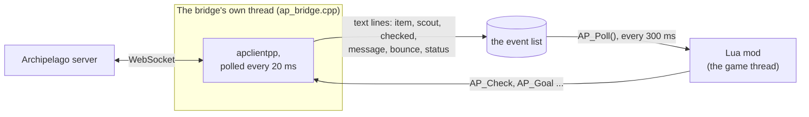

Nothing on the bridge's thread touches the game or Lua: the event list is the only thing the two threads share.

- `ap_bridge.cpp` runs apclientpp (the standard C++ Archipelago client) on its own thread, polled every 20 ms, and
  turns everything the server sends into text lines in an event list: `item`, `scout`, `checked`, `message`,
  `bounce`, `status` (the format is in `ap_bridge.hpp`). It needs no Unreal, so it is tested on Linux
  (`tools/bridge_test.sh`).
- `dllmain.cpp` registers the `AP_*` functions into the Lua mod when it starts; the list is at the top of the file.
- The Lua mod calls `AP_Poll()` every 300 ms on the game thread and acts on each line; it sends checks with
  `AP_Check`.
- When the server drops, apclientpp reconnects by itself, and the bridge joins the slot again when the server sends
  `RoomInfo`; the Lua mod (`onConnected` in `connection.lua`) then re-reads the slot data and sends every check
  again: the ones read from the game's records at the next records phase, the ones it sent itself (purchases,
  removed slots: `ap.bought`) at once, and the goal.
- Beside the mod: `client_uuid.txt` (one id per installation, so the server recognises the client) and `cacert.pem`
  (trusted certificates for `wss://`).

### The game half: Pal gifts, the map screen, pictures

The rest of the connector calls Palworld's own functions, or does image work too slow for Lua.

- `reflect.hpp` is how C++ calls a game function: `ReflectedCall` looks the function up by path, builds a parameter
  block of the function's own size, finds each parameter **by name** (checked to lie inside the block) and calls
  `ProcessEvent`. `resolve()` takes the function from the object's own class first, because a Blueprint event's C++
  version is an empty stub. Crashes inside game code can't be caught, so every step checks first and throws
  `Fail{"reason"}`, which becomes the report's `result: fail <reason>`.
- `pal_gift.cpp` gives a Pal (`AP_GivePal`, `AP_GivePalPoll`): it finds the player fresh on every call, has the game
  make the Pal's save data, then creates it by one of four routes (two party callbacks, a plain create and add, or
  the Palbox import) and looks for it in the party or the Palbox. A Pal not there yet is kept as one pending gift
  and looked for on each poll, for about 6 s. The header says what each route calls and why. Only the test tools
  use it so far. `pal_gift_logic.*` holds the parts that need no Unreal (arguments, route choice, the report text,
  poll counting) and is tested on Linux.
  Why C++: no Lua route works. Two crash the game (drop and pick up, and the character manager: UE4SS's Lua can't
  pass a Pal's save parameter struct, as `pal_gift.cpp`'s header explains); the captured cage makes a Pal handle but
  never a Pal in the world. Which routes have worked in game is in `pal_gift.cpp`'s header; `test_tools=1` gives one
  key per route (listed in `test_tools.lua`'s header). Like the game's own create, it works only where the game has
  authority: single player or a listen-server host, not a client of a dedicated server. If every route fails, a
  Blueprint function in a LogicMod pak is the fallback: it can build the save parameter itself and call
  `CreateIndividual` with a real callback.
- `map_screen.cpp` makes the world map show the mod's picture instead of the game's: post-callbacks on the Blueprint
  VM catch `WBP_Map_Body_C:Setup` and set the picture and the fog before the screen draws. Every 60 frames it looks
  for Setup again, because the map's class is loaded anew after Return to title. Lua drives it with
  `AP_MapScreen(cmd, value)`.
- The map pictures are built from PNGs, on background threads (one `JobSlot` each, `image_jobs.cpp`; Lua polls
  `busy`, `done` or `error: ...`): the Territories map (`compose_field`, falling back to `compose_territories`, in
  `image_territories.cpp`), the chart style (`compose_chart` in `image_chart.cpp`, `compose_fog` in
  `image_fog.cpp`), and the grey map and the small PNG tools (`compose_map`, `greyscale_png`, `sample_png` in
  `image_grey_map.cpp`). They share `image_basics.*` (the locked-area list, blurs, PNGs as floats) and
  `image_land_sea.*` (land, sea and beyond the world's edge). Lua passes locks, walls and looks as short text
  formats, each described above its function in `image_tools.hpp`, the one header Lua's side cites. Tested on Linux
  (`test/image_test.cpp`).

## The Lua mod

`mod/PalworldArchipelago/Scripts/`. `main.lua` starts everything and runs the core update; every other file is a
module it calls. The tables in this section list every file in the folder once, by topic, each with its job (the
file's own opening comment says more):

- [`main.lua` and the core files](#mainlua-and-the-core-files)
- [The walls and the map](#the-walls-and-the-map)
- [The glows](#the-glows)
- [Traps, crates and the HUD](#traps-crates-and-the-hud)
- [The menus](#the-menus)
- [The mailbox](#the-mailbox)
- [Shared modules](#shared-modules)
- [Opt-in diagnostics](#opt-in-diagnostics)
- [Generated tables](#generated-tables)

### `main.lua` and the core files

`main.lua` is two things: the update loop, and the start-up list (`start()` at the end of the file, with the rules
for its order). Everything else the core does lives in a file of its own. A core file takes the other core files
with `require`; what only `main.lua` can give (the mod's folder, the version) comes through its `install(env)`, as for
the other modules.

| File | What it holds |
|---|---|
| `main.lua` | The core update (`update()`, its steps drawn below), the phase table (`PHASE_STEPS`), the glows' step (`updateGlows`) and the start-up list (`start()`). |
| `clock.lua` | The update count (`CLOCK.now()`), the waits (`WAIT`, in seconds), the cycle of phases (`PHASE`, `isPhase`) and `CLOCK.seconds`. |
| `ap_state.lua` | The table `ap`: the connection, the seed and its progress, each field with when it is forgotten. The connection's four states are listed above it, and `STATE.setStatus` is their only writer. Slot data is read through `slot_data.lua`. |
| `slot_data.lua` | What the APWorld sends the slot: `SLOT.KEYS` lists every key the mod reads and what for; `SLOT.text`, `SLOT.flag` and `SLOT.number` read them and refuse a key not listed. The harness checks each key against the APWorld's `SLOT_DATA_OPTIONS` and `fill_slot_data`. |
| `config.lua` | `config.txt`: read at start-up into `CONFIG.cfg`, written back by the title menu's connect (`CONFIG_KEYS`), and the saved servers. |
| `save.lua` | `save-<seed>-<slot>.txt` beside the mod: what the server cannot send again (its lines are listed above `SAVE.path`). Written whole to a `.tmp` file and then moved into place, so a crash never leaves half a file. |
| `world_seeds.lua` | `worlds.txt` beside the saves: which seed and slot each world folder is played in (its format is above `indexPath`), kept in step by every save written with a `world=` line. A game started offline reads it to know the loaded world's seed (`SAVE.seedOfWorld`). An index file, as Lua cannot list a folder. |
| `player.lua` | This update's player, looked up once (`PLAYER.lookUpFrame`: the frame record and its fields), `playerPawn`, `pawnXY`, and `notify`, the chat notice (`announce` without the mod's prefix). |
| `world.lua` | The world step (`WORLD.note`: which world, how long ago it loaded, what each module forgets when it changes) and the seed's world (`checkWorld`, `tieWorld`). |
| `tech_lock.lua` | The game's list of researched techs holds the techs items unlocked and no other shop tech (`lockAndUnlockTechs`); the techs a seed leaves as normal research (`research.txt`). |
| `items.lua` | What each kind of item does on arrival (`onItem`) and once per seed (`applyItems`, with a table of kinds above it), crates, bundles and Nomad's gifts, all handed over to the mailbox (`handOver`). |
| `records.lua` | The player's records as location ids: levels, captures and the Paldeck, towers, alphas and fast-travel points (the record keys it reads are listed in its header). |
| `checks.lua` | Checks from the game's records (`pollRecords`, `sendChecks`) and the goal (`goalReached`, `sendGoalOnceOutOfArena`). |
| `shop_cards.lua` | What each shop card shows (`relabel`, `cardLabel`, `cardPicture`), relabelled only when it changed. |
| `shop.lua` | The shop's seven hooks (`SHOP_HOOKS`) and buying a slot (`buy`). |
| `connection.lua` | Connecting (`connectTo`, at start-up `connectFromConfig`), the server's events (`readEvents`, `EVENT_HANDLERS`), the seed's options, what a new seed forgets (`resetSeed`) and when the connection is ready (`markReady`). |
| `held_notices.lua` | Notices held through a loading screen. |
| `keybinds_check.lua` | Whether UE4SS's own Keybinds mod is on (its Ctrl+H header dump, set off by the hint key while crouching, crashed the game), and a chat warning once a session saying how to turn it off. |
| `run_style.lua` | Run Style (Nomad's hand-overs, `RUN_STYLE.gifts`) and Speed Boost: the world settings it multiplies (`RUN_STYLE.apply`), the world's own values (`syncbase=` in the save) and the warning. |
| `death_link.lua` | Death Link: the faint routes (`ROUTES`), a death received, the player's own death and the amnesty. |
| `techscan.lua` | Other mods' techs: the scanner, and the once-a-session scan (`TECHSCAN.phase`) that sends the checks of slots another mod removed. |

The connection's four states (`ap.status`; `STATE.setStatus` in `ap_state.lua` is their only writer):

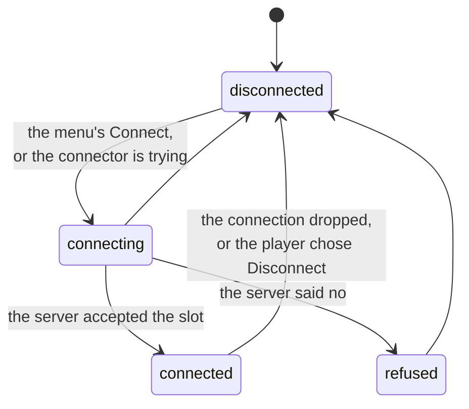

Only while `connected` are checks sent and items received; the player can play in every state.

How it works:

- **The server is the truth:** every connection re-sends all items received and every location checked, so most of
  `ap` is rebuilt each time. Only one-off effects (points, bundles, crates, traps, the mailbox, Death Link's
  forgiven count, visited locks, slots bought while offline) are kept, in the save file. Beside the saves,
  `worlds.txt` names each world's seed and slot, so a game started offline loads the right save.
- **Items** are applied in the order the server numbers them, and `ap.given` remembers how far that got, so a
  reconnect never gives a crate or tech points twice. A tech item doesn't touch the game directly:
  `lockAndUnlockTechs` makes the game's list of unlocked techs match the items received.
- **Checks** come from the game's own records (`records.lua`): levels, captures, alphas, fast travel, towers, and
  the shop. `sendChecks` sends each one once per session, only while connected. The goal waits until the player
  leaves the boss's arena.
- **The tech shop.** Level 2 and higher techs are slots: each card says what its slot sends. When the player buys
  one, the research request is renamed (`AP_ShopSlot`, a tech that doesn't exist), so the game unlocks nothing;
  `buy()` takes the points itself, marks the slot bought (`ap.bought`, in the save) and sends the check. Other hooks
  make a bought card look researched, decide whether a slot can be clicked, and put what the purchase sends into the
  confirm box. Where it can be bought:
  - In a world that is not the seed's, nothing is a shop slot (`SHOP_CARDS.isShopSlot`): the request is left to the
    game, so plain Palworld research works there, and the cards give the game's own answers.
  - In the seed's world with the connection dropped (the seed known from this session's connection, `ap.shopOpen`),
    a purchase goes through and its check is sent when the connection is back (`CHECKS.sendBoughtAgain`). Untested
    in game.
  - Started offline in a world `worlds.txt` names (`CONNECTION.knowSeedOffline`, once per pawn while not
    connected): that seed's save is loaded and the shop opens, so a purchase is queued the same way. Cards show the
    unscouted "Archipelago item" until the seed connects and scouts. Nothing else runs offline: no item is applied,
    no tech locked, and the game's records are sent on connecting. Connecting to the same seed and slot carries on;
    another seed resets as usual, and what was queued for the old seed stays in its save for its next connection.
    The research techs are the last connected seed's (`research.txt`). Untested in game.
  - Started offline in a world with no known seed (new, or vanilla), nothing is bought, and the game unlocks nothing.
- **Server events** arrive as text lines from `AP_Poll()`; `onEvent` hands each to its handler, whose parameters
  name the line's fields in the order `ap_bridge.hpp` sends them. "Connected" reads the seed's setup from slot data
  (`onConnected`, `applySeedOptions`).
- **A seed belongs to one world**, the first one it is played in (`checkWorld`, `world=` in the save, and its line in
  `worlds.txt`). In any other world nothing is locked, sent or given, and the mailbox and the crates stay shut. A
  first world that already has shop techs researched is tied only after the player presses the hint key
  (`tieWorld`), since tying it locks those techs again.
- **The update** (`update()` in `main.lua`) runs every 300 ms on the game thread, at most once a frame and never
  inside a hook. Every update it runs the work queued in `soon.lua` and the timers, reads the server's events, and
  updates the menus, mailbox, shop cards, walls, map and glows. The heavier work is spread over a cycle of 7 updates:
  `PHASE_STEPS` maps each phase to its function (records and checks, the other mods' tech scan, items and Death Link,
  visited locks, the wall's notice).
- **Death Link** faints the player by the first of three routes that works (lethal poison, the Death Penalty's bag
  then a self-kill, a plain self-kill), and sends a death after the slot's amnesty is used up.

**The update**, as `update()` in `main.lua` runs it: the steps every time, then the one phase whose turn it is
(`PHASE` in `clock.lua`; phases 4 and 6 have none).

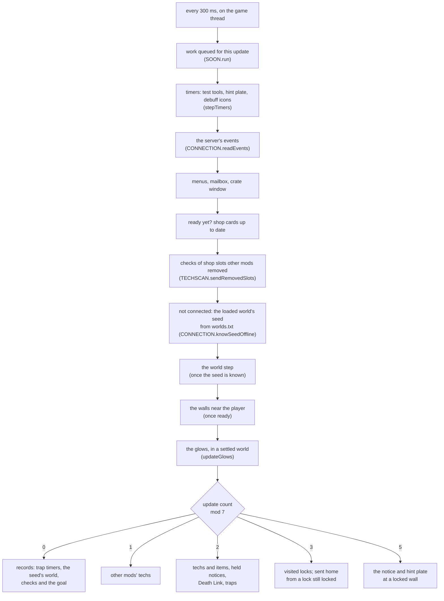

**An item's kind** decides what it does (`DATA.items[id].kind`; the table above `ITEMS.applyItems` in `items.lua`).
The arrival step runs on every connection; the one-off step runs once per seed, for items past `ap.given`:

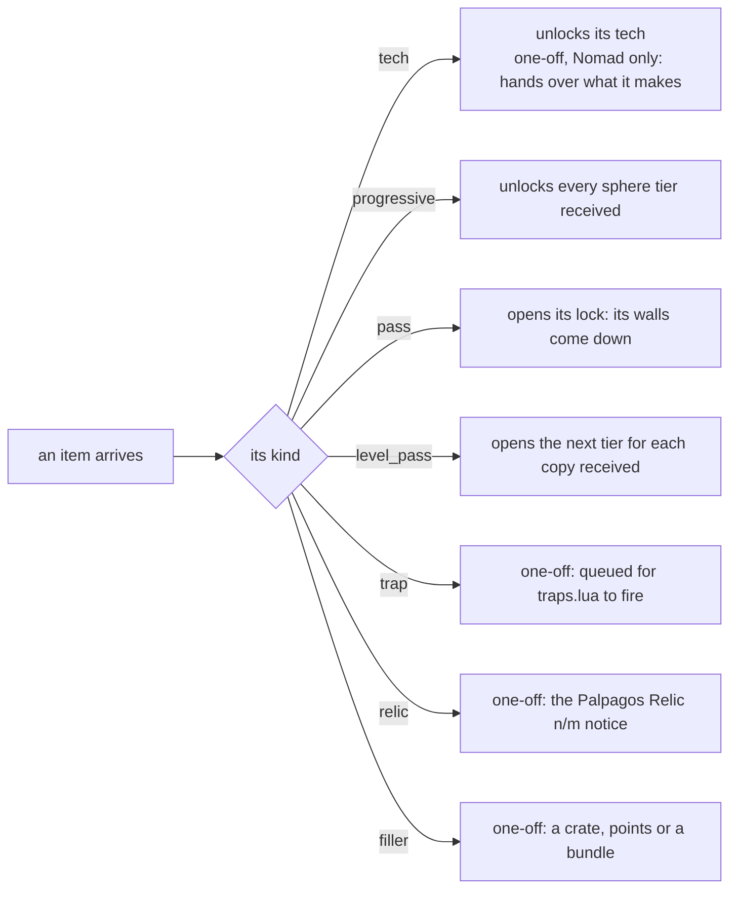

**Buying a shop slot**, by where the player is:

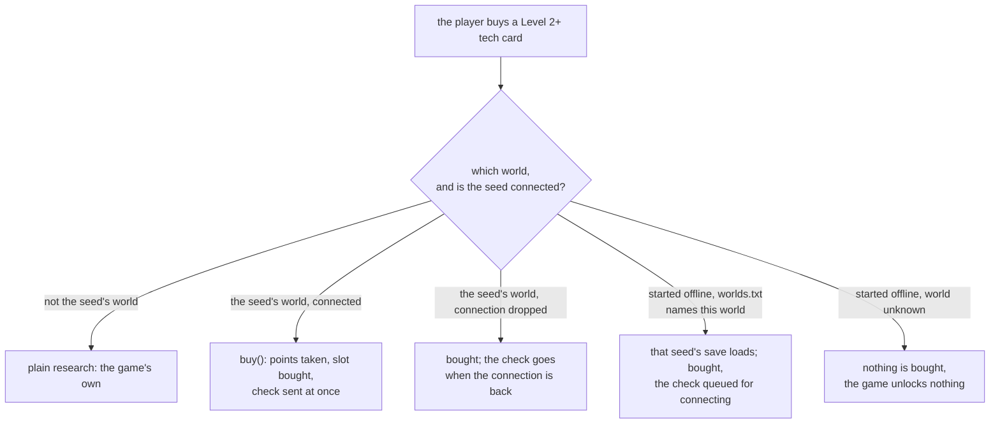

### The menus

`menu.lua` wires the mod's menu buttons. In a world they are `menu_world.lua`'s; on the title screen it runs the
Archipelago menu through `menu_title.lua`, which uses three files of its own.

| File | What it holds |
|---|---|
| `menu.lua` | The mod's buttons in the game's menus, built from the game's own widgets; its update runs the title menu, the in-world buttons and the text window. Wired by `main.lua`. |
| `menu_world.lua` | In a world: the "Archipelago Mailbox" button on the Esc menu and on the Inventory page, and the crate button beside the latter. |
| `menu_names.lua` | The names the menu files share (`NAMES`): the game's class paths, widget fields and events they depend on (`GAME`), their waits, schedules and sizes, and the owners of their buttons in `clicks.lua`. |
| `menu_survey.lua` | The menus' diagnostics: log lines that let a playtest's log say what the client's menus are made of (the title screen, the layout round our buttons, the focus). |
| `text_window.lua` | The game's text window (the world-name window), one field at a time: the title menu's window layout types into it. |
| `menu_title.lua` | One record per title menu (`newTitleMenu`) and its life: finding the title menus (`TITLE.find`), building our rows on a new one (`buildTitleMenu`), bringing it up to date each update (`updateTitleMenu`), and giving it up when the menu goes (`dropTitleMenu`, `TITLE.forgetGone`). Also the title buttons' hover hooks and Esc. |
| `menu_title_banner.lua` | The banner above the title buttons: its art, the connection in its status pill (`BANNER.showConnection`), its tint and pop under the pointer (`BANNER.refreshLook`), and its place over the button list (`BANNER.listTop`). |
| `menu_title_rows.lua` | The rows built: the typed layout (`ROWS.buildTyped`), else the window layout (`ROWS.buildWindow`), each row's dark backing (`backed`), the typed rows' text boxes, the saved servers' panel, and every button claimed for its click (`ROWS.addRow`). |
| `menu_title_connect.lua` | What the rows say and do: the draft the menu will connect with (`draftNow`), each kind of row's label, click and when it shows (`ROW_KINDS`), the typed boxes read back (`readEdits`), Connect or Disconnect, and folding the menu once connected (`CONNECT.followConnection`). |

Which file uses which (an arrow is a `require`; every one of them also uses `menu_names.lua`):

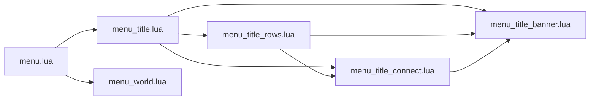

### The mailbox

`mailbox.lua` keeps the mailbox's list and opens it. Without the LogicMod window (`mailbox_window.lua`) it shows the
list in the game's own chest window on a hidden chest, through `mailbox_chest.lua`, which uses four files of its own.
The chest view (the window it opened) is `mailbox_chest.lua`'s state; the other four are handed it. The list is the
truth: a take leaves it (and the mod's save file) at once, while the item in the bag is kept only by the game's next
world save, so an item taken just before a crash is lost rather than given twice (`mailbox_chest_slots.lua` says so).

Gear and accessories (from a crate or a Nomad tech) wait in a list of their own, `M.gear` (`mailgear=` in the save):
they carry per-item data (durability, the ammo loaded) a chest slot written by the mod would not have. `handOutGear`
gives them to the bag through the game's own `AddItem` the first update the mailbox is open, and again when more gear
arrives while it is; what the bag refuses waits for the next open. The game may put a piece straight into an empty
equipment slot, but only after `AddItem` returns, so `mailbox_gear.lua` reads where each piece went half a second
later: worn ("now equipped"), or in the bag, from where a piece is moved on into the chest window by the game's own
move (`mailbox_chest_gear.lua`), so the player sees it in the mailbox. Gear the player leaves there goes to the bag as
the window closes, and the player is warned of that whenever gear arrives. When the move does nothing, the piece
stays in the bag and the player is told so.

| File | What it holds |
|---|---|
| `mailbox.lua` | The mailbox's list (in the save file, with no limit), its gear list (`M.gear`), its states and the moves between them (listed at the top of the file), opening it from its buttons or `mailbox_key`, and handing out gear (`handOutGear`). |
| `mailbox_window.lua` | The UI pak's own window (`WBP_APMailbox`, from `logicmod/`): one row per item, filled by the mod, whose buttons' `AP_Clicked` it answers. Skipped with `mailbox_view=chest`. |
| `mailbox_gear.lua` | Where each piece of handed-out gear went, read `SETTLE_WAIT` after the game's `AddItem`: worn ("now equipped"), or in the bag, to be moved on into the chest window. |
| `mailbox_chest.lua` | The hidden chest made once per world (`CHEST.startMaking`, `CHEST.followMaking`) and kept from decaying (`harden`), its window opened (`CHEST.open`), followed every update until the player closes it (`CHEST.followView`), and closed (`CHEST.close`). |
| `mailbox_chest_slots.lua` | The chest's slots: emptied of copies and filled from the list as the window opens (`SLOTS.emptyThenFillChest`), emptied back into the list as it closes (`SLOTS.absorb`), and the slot helpers the sweep also uses (`SLOTS.put`, `SLOTS.clear`). |
| `mailbox_chest_sweep.lua` | Every update while the window is open (`SWEEP.run`): what the player took comes off the list, deposits go back to the bag, and items received go into the slots that empty; and the rule that refuses deposits (`SWEEP.lockPermission`). |
| `mailbox_chest_gear.lua` | The mailbox's own gear: a piece moved in from the bag by the game's move, the slot and the chest letting that item in until it arrives (`CGEAR.moveIn`, `CGEAR.follow`), and the pieces left in the chest sent to the bag as the window closes (`CGEAR.sendLeftToBag`). The sweep leaves these pieces alone (`view.gearMine`). |
| `mailbox_chest_heading.lua` | The window's heading set to the mailbox's name, and the mailbox emblem beside it (`HEADING.dress`). |

The chest window's life, from the mailbox's side:

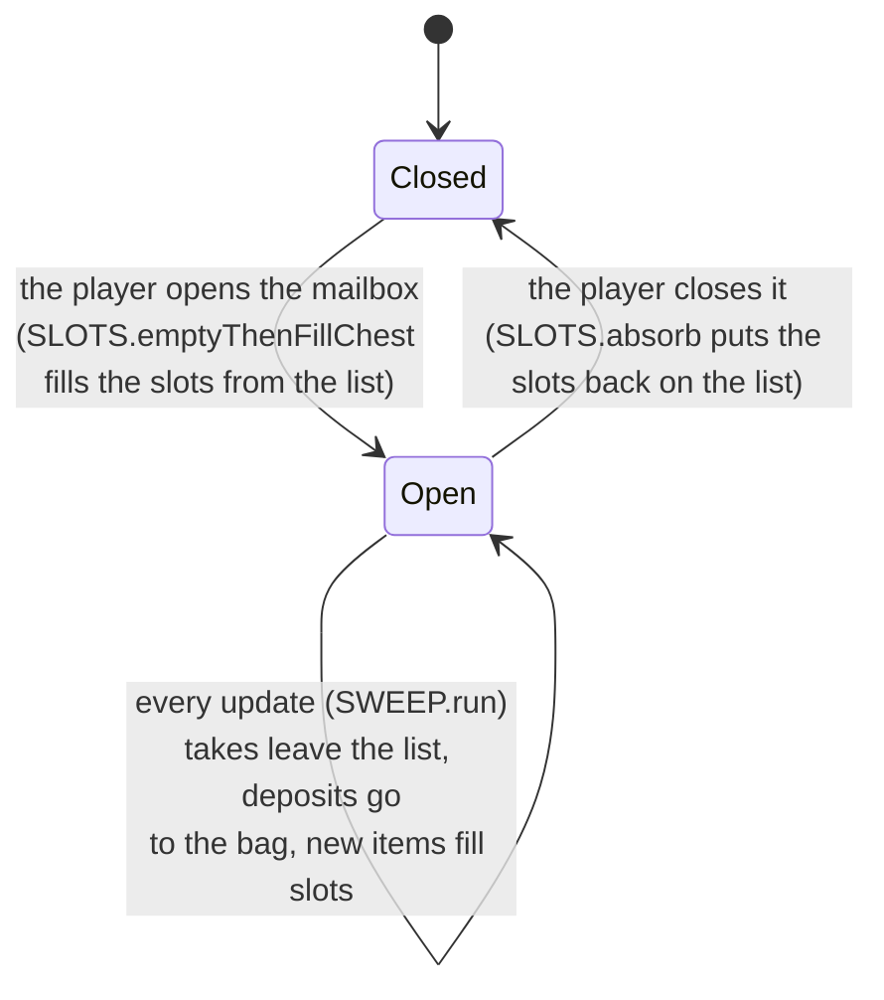

### The walls and the map

Area Locks wall the map off into locks (regions, areas or tiers, by Lock Size) and show the locks still locked on the
world map. `area_locks.lua` decides when the walls act. `walls.lua` keeps the wall pieces and is the table the rest of
the mod sees (`W`); its five parts are loaded fresh with each copy of `walls.lua` (the harness loads it again for a
fresh start), each handed `W` by its `install`. Where each lock lies comes from the generated tables of the seed's
lock size ([Generated tables](#generated-tables)), which `locks.lua` loads by their prefix (`region_`, `area_` or
`level_`).

| File | What it holds |
|---|---|
| `area_locks.lua` | When the walls act (`AREA_LOCKS.update`), the visited locks, sending the player home from inside a lock still locked, the flying corridors flown through (`ap.flown`), and the walls' settings from config.txt (`configureWalls`). |
| `walls.lua` | The wall pieces: the game's own blocking wall (`BP_PalBlockingVolume`) stretched along every border between locks, raised, hidden, opened and forgotten (`W.update`); a piece stays up while either lock beside it is locked. Its header lists `W`'s fields. |
| `locks.lua` | The seed's cut of the map (its walls, names, grid and centres), which lock a spot is in (`lockAt`), whether a piece stands (`standing`), the locks beyond the goal, and the lists of locked and open locks the walls and the map draw from. |
| `wall_skins.lua` | The walls' looks (each region's own wall, the cream paws, the region colours, the game's red grid), their materials on the Art pak's `M_APWall`, the dissolve of an opened wall and the glow near the player. |
| `map_picture.lua` | The world map's picture with the locks still locked: composed by the C++ part from the player's saved colour map (`map-colour-1.png`, saved from the game's map the first time it opens) and the lock labels, or drawn in Lua without it. |
| `map_fog.lua` | What the C++ map screen is told (`AP_MapScreen`: switched on, the picture, the fog colour and picture), when the map is on screen, the explored mask, the explorer's chart and the fog picture. |
| `map_icons.lua` | The locks as icons on the map screen, one size at every zoom: a stamp on each locked one, an open stamp on each one unlocked but not yet visited, and a fly-up icon where each flying corridor starts until it is flown. |
| `wall_hints.lua` | The notice at a locked wall (the pass it needs, and where it is if a hint said so), buying that hint with the hint key (`bindKey`, `askHint`), and the server's chat read for those hints (`onMessage`, `parsePassHint`). |

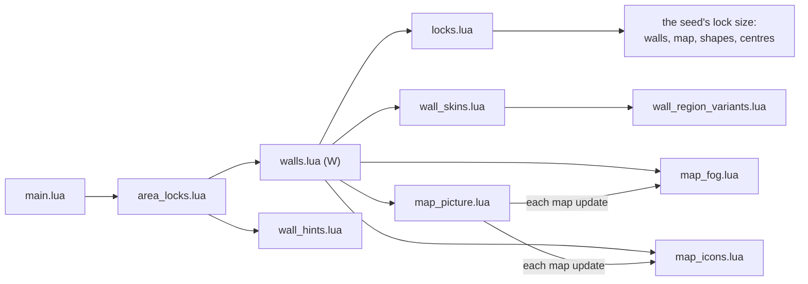

Level Progression (Lock Size: levels) adds flying corridors: walled lanes up to a tier that only higher tiers
surround. Their two mouths are `corridors` in `level_walls.lua`; `area_locks.lua` marks one flown once the player
passes its far mouth (`ap.flown`, kept in the save); `map_icons.lua` shows a fly-up icon at its near mouth until then;
and `map_picture.lua` hands the C++ part `level_flying.png` (`tools/flying_picture.py`), which stripes the corridors
on the map.

### The glows

The glows are visual only and need the Art pak's glow assets; `glow=0` in config.txt turns them off. `main.lua`'s
`updateGlows` steps them each update, in a settled world only.

| File | What it holds |
|---|---|
| `glow_pieces.lua` | What the glows are made of: the Art pak's glow meshes and textures and its `M_APGlow` material, the looks made from it, and plain engine StaticMeshActors wearing them; the `glow=0` switch, and forgetting every piece at a world change. |
| `glow_checks.lua` | The check glow: a halo, a soft light and a pillar of light round each object near the player that is still a check in this slot (`KINDS`: fast-travel statues so far), shown within `RADIUS_CM`. |
| `glow_burst.lua` | The item-arrival burst round the player, coloured by the item's flags; items arriving together make one burst (`items.lua` calls `noteArrival`). |
| `fast_travel.lua` | The loaded fast-travel statues still locked (`lockedPoints`), shared by the check glow, the test tools' unlock probe and `records.lua`. |

### Traps, crates and the HUD

| File | What it holds |
|---|---|
| `traps.lua` | Traps: Slow, Hunger, Teleport and Fool (`TRAP_KINDS`, each with what it waits for and what it does), queued once per item index and kept in the save until they fire. |
| `debuffs.lua` | The traps' icons at the top of the HUD: one tile per running effect, a timed one with its time left under it. |
| `crates.lua` | Palworld Crates: a received crate's roll into one of five kinds (fixed by the seed and the item's index), the crates kept in the save, and what one holds when opened (from the player's level then). |
| `crate_window.lua` | The Palworld Crates window over the mailbox's chest window: a row per kind waiting, the chosen kind's details, the last crate opened, and the small button that brings the window back. |
| `hint_popup.lua` | The hint plate at a locked wall and the goal banner, on the HUD, taken down when their time is up or the world goes. |

### Shared modules

What every part of the mod uses. The style guide's [Building blocks](style-guide.md#building-blocks) say which
function to use for which job.

| File | What it holds |
|---|---|
| `util.lua` | The log and log-once (`log`, `once`, `onceIn`, `onceErr`, `took`, `logger`), guarded calls (`safe`, `attempt`), an object's address (`addr`), objects kept alive (`keepAlive`, `keepInPlace`), the hook guard (`guardedHook`), the update period (`UPDATE_MS`, `updates`, `isDue`), hooks that wait for their class to load (`hookWhenLoaded`), files (`replaceFile`, `readFile`, `exists`) and key binds (`bindKey`). |
| `soon.lua` | Work for the next few core updates (`SOON.later(n, fn)`), run on the game thread at the start of each update: the mod's stand-in for UE4SS's `ExecuteWithDelay`, which runs off the game thread. |
| `widgets.lua` | Making and reading game widgets (UMG): the engine's enum values and UMG class paths, with the engine's own names, and the small makers the window files share (`hudCanvas`, `hudBox`, `pinToCanvas`, `textLine`). |
| `clicks.lua` | Clicks on the mod's own buttons: the click hook only notes a click, and the button's owner runs it in its next update (`CLICKS.claim`, `CLICKS.run`), because work inside the hook can remove the button being clicked. |
| `art.lua` | The mod's own images (`art\*.png`), each loaded once a session and kept alive (`ART.texture`, `ART.file`, `ART.box`). |
| `bag.lua` | The player's bag: giving items to it (`BAG.give`), item names in the player's language and stack sizes, and the live controller's address (`BAG.worldKey`). |

### Opt-in diagnostics

Both ship with the mod and do nothing unless config.txt turns them on.

| File | What it holds |
|---|---|
| `perf.lua` | The performance probe (`perf_log=1`): it times, counts and logs, with A/B hotkeys under `test_tools=1`; with the probe off every function is an empty stub. Its log lines are explained in [`mod/PERF-PROBE.md`](../mod/PERF-PROBE.md). |
| `test_tools.lua` | The test tools (`test_tools=1`): hotkeys for what only the game can answer (EXP, a trap now, Pal gifts through the connector, the fast-travel unlock probe and more), each step logged as a `[test]` line. Its header lists every key. |

### Generated tables

Never edited by hand: each is made by a script in `tools/` ([Generated files](#generated-files)).

| File | What it holds | Made by |
|---|---|---|
| `ap_data.lua` | Every item and location with its id and kind, from the APWorld's `data.py`, so the mod and the APWorld agree | `tools/gen_lua_data.py` |
| `tech_icons.lua` | Each tech's icon texture | `tools/gen_tech_icons.py` |
| `tech_gifts.lua` | What Run Style "Nomad" hands over with each tech | `tools/gen_tech_gifts.py` |
| `area_regions.lua` | Each of the 75 areas and the region it is in | `tools/area_regions.py` |
| `wall_region_variants.lua` | Lock Size: areas: which version of its region's wall each area wears | `tools/wall_region_variants.py` |

The tables of each lock size, made by `tools/lock_walls.py` (walls, map, shapes) and `tools/lock_centres.py`
(centres), one run per size:

| What it holds | Regions | Areas | Tiers |
|---|---|---|---|
| The locks' names and the wall pieces (middle, length, direction, the lock on each side); for the tiers also the flying corridors | `region_walls.lua` | `area_walls.lua` | `level_walls.lua` |
| Which lock every 29 m of the main map is in | `region_map.lua` | `area_map.lua` | `level_map.lua` |
| Each lock's outline cut into triangles, for the map | `region_shapes.lua` | `area_shapes.lua` | `level_shapes.lua` |
| Each lock's deepest point and where its map stamp goes | `region_centres.lua` | `area_centres.lua` | `level_centres.lua` |

## The LogicMod paks

Two Unreal paks, each built by hand in the Palworld Modding Kit on Windows; the Lua mod works without either.
`PalworldArchipelagoArt.pak` (the Art pak) holds the walls' material and the glows, and is attached to every release.
`PalworldArchipelagoUI.pak` (the UI pak) holds the mailbox's own window and is not released yet. How to build both:
[`logicmod/README.md`](../logicmod/README.md).

## Tests, tools, CI and releases

### Tests and the build

- `tools/ap_tests.sh` runs Archipelago's own test suites for this world (unique names and ids, filling a multiworld,
  the docs pages, the website), then the world's own tests in `apworld/palworld/test/`:
  - `test_ids.py`: ids never move (every name and id, frozen in `frozen_ids.tsv`);
  - `test_logic.py`: the level climb, mounts for the sea and the sky;
  - `test_progression.py`: each goal's plan (cap, passes, Regions Beyond the Goal, Gear Logic, the points budget);
  - `test_areas.py`: Lock Size: areas;
  - `test_levels.py`: Lock Size: levels (passes in order, the flying pieces, a seed's tiers without a gap);
  - `test_options.py`: refused options, and what reaches the mod's slot data.
- `tools/test_generate.sh N` builds the `.apworld` as players get it and generates N seeds, checking each is
  beatable.
- `tools/lua_harness.sh` runs the Lua mod's harness (`mod/test/harness.lua`), in CI too. It copies the mod to a
  fresh folder, writes its `config.txt`, and runs the harness twice: as a player runs the mod, and with the
  performance probe and its test hotkeys on. The harness loads the mod's Lua unchanged against stand-ins for
  UE4SS, the game and the APConnector (`fakes.lua`, `fakes_map.lua`, `fakes_menus.lua`), then runs the test files in
  `mod/test/tests/` in the order `harness.lua` lists them. Each file is a list of groups,
  `group(title, function() ... end)`, and each group starts from the state the ones before it left: the seed, the
  save file, the items received, the world. A failed check prints its group, its file and its line. The table of
  contents and the steps for adding a test are in `harness.lua`'s header; the harness's own building blocks are in
  the style guide.
- `tools/cpp_tests.sh` builds and runs the APConnector's Linux tests with g++ (`cppmod/APConnector/test/`: the map
  pictures, the Pal-gift logic, the text arguments, the event lines), then `check_lua_api.sh`, which checks that
  `dllmain.cpp`'s function list, its registrations and the Lua mod's calls agree. CI runs the same script.
- Every `.apworld` (tests, playtests, releases) is made by `tools/build_apworld.py`. It adds the manifest fields
  Archipelago needs and checks that the world loads with its own version; a plain zip of the folder loads as 0.0.0
  and players' YAMLs are refused.
- Point `AP_DIR` at your Archipelago folder (with its venv in `.venv`), of the version
  `apworld/palworld/archipelago.json` names as `minimum_ap_version`. Without it the tools look for
  `archipelago-<that version>` beside this repository's folder (`tools/ap_dir.sh`), which is wrong in a git worktree.

How `tools/lua_harness.sh` runs the Lua mod's tests:

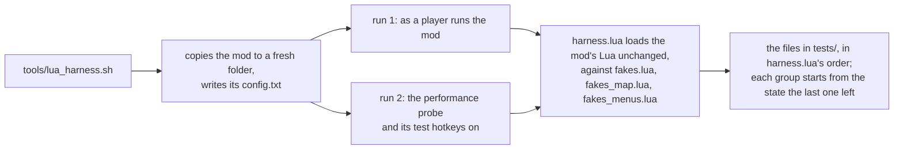

### Tools

[`tools/README.md`](../tools/README.md) lists every tool: what each generator makes and reads, and whether it needs
the private game files (the table dumps, the map picture, the region volumes) and how to make them, with the steps
after a game update; the build and the test runners; the two test clients for a live room (`deathlink_send.py`,
`send_checks.py`); the modules the tools share (`lock_groups.py`, `towers.py`, `table_dumps.py`,
`apworld_loader.py`); and the server probe that dumps the tables. Each script's header gives its command and says how
it is tested.

### CI

`.github/workflows/ci.yml` runs on every pull request, on a push to `main` or to a `build/<name>` branch, on a version
tag (`v*`) and when started by hand (Actions > CI > Run workflow). A push to any other branch runs nothing. A newer
push to the same branch or pull request cancels the run before it. Its jobs:

| Job | What it does |
|---|---|
| What changed (`changes`) | Decides whether the Windows build runs: always for a tag, `main` and a run started by hand; otherwise only when `cppmod/` or `ci.yml` changed since the newest commit of this branch (or, for a new branch, of its pull request's base) whose Windows build passed. |
| APWorld on Archipelago (`apworld`, Linux) | Checks that its Archipelago version is `minimum_ap_version` in `archipelago.json` and that `world_version` is the mod's `VERSION` without its `-dev.N`; compiles the APWorld on Python 3.11; installs Archipelago; checks `ap_data.lua` is current (`gen_lua_data.py`) and runs `tools/lua_harness.sh`, `tools/cpp_tests.sh` and `tools/ap_tests.sh`; generates test seeds (`tools/test_generate.sh`: the defaults, eight towers, and no locks); builds `palworld.apworld` (an artifact, `palworld-apworld-<commit>`); and runs `tools/test_options_page.py`. |
| C++ mod (Windows) (`cppmod`) | When the changes job says so: fetches UE4SS's source (Okaetsu's Palworld build, at a fixed commit, through the `UEPSEUDO_TOKEN` secret), apclientpp and its dependencies, and OpenSSL and zlib through vcpkg (cached between runs); builds `APConnector.dll`; and packages it with `cacert.pem` and the Lua mod as the artifact `PalworldArchipelago-mod-<commit>`, laid out as the game's `ue4ss/Mods` folder. A failed build's errors are posted as an annotation ("Report build errors"), since job logs need admin rights to read. About 25 minutes. |
| Draft release (`release`) | On a version tag, after both jobs above: checks the tag is `v` plus `VERSION`, zips the mod, writes `SHA256SUMS.txt` and the draft notes, and makes a draft release. |

A Windows DLL for a playtest without a pull request: push the branch under the name `build/<name>`
(`git push origin <branch>:build/<name>`), wait for the run, and download the `PalworldArchipelago-mod-<commit>`
artifact from its page (Actions, the run, Artifacts). A branch that already has a pull request open is built by its
pull request instead.

### Releases

One version number names a release: the mod's `VERSION` in `main.lua`, which during work carries a `-dev.N` suffix
(`1.2.0-dev.4`, say), and the APWorld's `world_version` in `apworld/palworld/archipelago.json`, which is always that
version without the suffix (`1.2.0`). CI's apworld job fails when they differ.

Before tagging, on `next`:
1. Set `VERSION` to the release, with no `-dev.N`, and `world_version` to the same.
2. Run `tools/gen_options_page.py`, then `tools/test_options_page.py` (the options page carries the APWorld's
   version).
3. In `CHANGELOG.md`, turn "Unreleased" into the version's section.
4. Run the tests (`tools/ap_tests.sh`, `tools/lua_harness.sh`, `tools/cpp_tests.sh`, `tools/test_options_page.py`)
   and judge each by its exit code.
5. Merge `next` into `main` through a pull request, then tag `main`'s merge: `git tag v<version>`, then
   `git push origin v<version>`.

The tag makes CI's release job draft a release with the mod zip, `palworld.apworld` and their checksums. A person
then:
1. attaches `PalworldArchipelagoArt.pak` (and its `.ucas` and `.utoc`, if the build made them), which CI can't
   build: it is built by hand in the Palworld Modding Kit on Windows (`logicmod/README.md`, "The wall material and
   the glows");
2. edits the drafted notes (they carry a reminder of step 1; the version's `CHANGELOG.md` section goes in them);
3. publishes it.

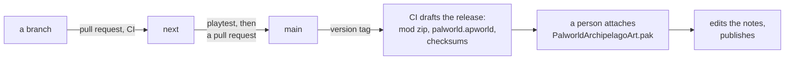

## Where to look when something breaks

Always first: open `UE4SS.log` and search for `[PalworldAP]` (the Lua mod) or `[APConnector]` (the C++ part), and
check that the version line (`[PalworldAP] loaded <version>`) is the build you think is installed.

| Symptom | Look first | Then |
|---|---|---|
| A check (a capture, a level, a tower) never reaches the server | The Lua mod: `records.lua` (does it read the record?), `checks.lua` (does it send?). Search the log for `[PalworldAP]`. | The APConnector, `AP_Check` in `dllmain.cpp` and `ap_bridge.cpp`: the mod sent it, but the server never got it. |
| A game update adds Pals, techs or items | Don't edit `game_data.py`. Dump the tables and run `tools/gen_apworld_data.py`, then `tools/gen_lua_data.py`. | `test/test_ids.py` proves no old id moved. |
| Can't connect, or the connection drops | The UE4SS log's `[PalworldAP] status:` lines (connecting, socket, connected; or refused, with the reason) | `ap_bridge.cpp`, `wire_handlers`; for a secure (`wss://`) server, that `cacert.pem` is beside the mod |
| An item or location has the wrong name or id | `data.py`: `_items()`, `_locations()`, and the name helpers (`shop_location`, `tech_item`, `region_pass`, `area_pass`) | `ap_data.lua` is generated from `data.py`; run `tools/gen_lua_data.py` after changing it. |
| A check is in logic too early or too late, or a seed won't generate | `__init__.py`: the check's rule in `set_rules`, then the helper it uses (`can_get_pal`, `shop_ok` ... there; `level_ok` in `levels.py`); a generation error comes from `generate_early` and its steps (`plan_map` in `map_plan.py`, `check_counts` in `checks.py`) | The tuning constants at the top of `levels.py` (`FREE_LEVEL`, `LEVELS_PAST_PIECE`, `LEVELS_BELOW_PIECE`, `SPHERE_STEP`); the spoiler log's playthrough shows when each item was reachable |
| A Pal gift ends `result: fail ...`, or the game dies during one | UE4SS.log's `[APConnector] [pal]` lines: the last one names the step, and the step names the function in `pal_gift.cpp` | After a game update: "function not found" or "no such parameter" means a path or parameter name in `pal_gift.cpp` changed; a UE4SS header dump of the new version (UE4SS's Dump CXX Headers) shows the new one |
| The world map shows the game's own picture or its dark fog | UE4SS.log's `[APConnector] [map]` lines: `hooked`, `Setup #n ... FAILED: <reason>`, `Setup gone` / `found Setup again` (`map_screen.cpp`) | `SETUP_PATH` in `map_screen.cpp` after a game update; `map_cpp=0` in config.txt turns it off; Lua's `AP_MapScreen` calls in `map_fog.lua` and `map_picture.lua` |
| The map picture looks wrong (colours, rims, walls, borders) | `compose_field` in `image_territories.cpp` for the Territories map; `compose_chart` in `image_chart.cpp` and `compose_fog` in `image_fog.cpp` for `map_style=chart`; land and sea told apart in `image_land_sea.cpp` | What Lua sends it (`lockSpec`, `wallSpec` in `map_picture.lua`); reproduce it on Linux with `test/image_test.cpp` |
| An item never arrives, or arrives twice | The log's `Received ...` and `save ...: items applied up to index N` lines; `applyItems` and `giveFiller` in `items.lua` | `ap.given` in the save file (`given=`): deleting the save makes every one-off item come again |
| A tech is locked that should be unlocked, or the other way round | The log's `locked <tech>` / `unlocked <tech>` lines; `lockAndUnlockTechs` in `tech_lock.lua` | Is this the seed's world? A `world: ... is not this seed's world` line means nothing is locked or sent here (`checkWorld` in `world.lua`) |
| Buying a shop slot does nothing, or the card shows the wrong thing | The log's `BOUGHT` or `buy ...: not enough points` lines; `buy()` and `researchRequested` in `shop.lua` | `relabel` in `shop_cards.lua` for what a card shows; `slotUnlockable` in `shop.lua` for whether it can be clicked |
| Death Link doesn't faint the player, or a death isn't sent | The log's `death link` lines: which route worked or failed, and `forgiven N of M` | `DEATH_LINK.step` and `ROUTES` in `death_link.lua`; the slot's `death_link_amnesty` |
| The options page or YAML template shows old text, or CI's options page check fails | `docs/options/options.json` is out of date: run `tools/gen_options_page.py`, then `tools/test_options_page.py` | The option's class in `options.py` (its docstring and `display_name`) |
| "This world already has progress" asks before the seed starts | The log's `world: <id> has N researched shop tech(s) ...` line: tying the seed would lock them again | `tieWorld` and `checkWorld` in `world.lua`; the hint key says yes |
| No walls, or walls in the wrong place | The log's `area locks: ...` lines (`no walls: <reason>`, `could not raise wall ...`) | `W.update` in `walls.lua` and `standing` in `locks.lua`; the wall rows are generated (`region_walls.lua`, `area_walls.lua`, `level_walls.lua`): run `tools/lock_walls.py` again, never edit them |
| Sent home when you shouldn't be | The log's `inside locked <lock>: sent home` lines | `area_locks.lua` and `lockAt` in `locks.lua`; inside a dungeon or tower it never happens (`IsInStage`) |
| No notice at a wall, or the hint key does nothing | A `hint_key=... is not a key UE4SS knows` line; the wall notice and hint lines | `wallNotice`, `askHint` and `bindKey` in `wall_hints.lua`; config.txt's `hint_key` |
| The mailbox won't open, or its items look wrong | The log's `mailbox:` lines | The list of states and moves at the top of `mailbox.lua` (closed, asked, window, making, opening, viewing, lost), then `mailbox_chest*.lua` |
| The Palworld Crates window won't come back | The log's `crate window:` lines (the button placed, the click hook in place, the click arrived) | `crate_window.lua` |
| The title menu's Archipelago rows are missing or odd | The log's `menu:` lines and the menu survey | `menu_title*.lua`, `menu_survey.lua` |
| No glow round a statue, or no burst when an item arrives | The log's `glow:` lines: `off (glow=0 in config.txt)`, `off for this session: the PalworldArchipelagoArt pak has no ...`, the first statues' places (`glow: <statue> at <x>, <y>, <z>; bounds ... cm, ...; glow on ..., scaled ...`), `an item-arrival burst (...)` | `KINDS` and `RADIUS_CM` in `glow_checks.lua`; `GLOW_BURST.update` in `glow_burst.lua`; the pak's assets come from `logicmod/make_glow_assets.py` |
| A trap "fizzled" or never fires | The log's `trap #N ...` lines (what it waits for, or `fizzled`) | The trap's entry in `TRAP_KINDS` in `traps.lua` (its `wait` and `run`) |
| The Lua harness fails | **The first FAIL line**: it names the group, the file and the line | Later FAILs are often the state the first one left behind |
| CI fails | Which job failed: "ap_data.lua is stale" means run `tools/gen_lua_data.py`; the Windows job's "Report build errors" step; "world_version is ... but main.lua's VERSION is ..." means set `world_version` in `archipelago.json` to `VERSION` without `-dev.N`; the release's "tag ... but the mod says ..." means `VERSION` in `main.lua` | `.github/workflows/ci.yml` ([CI](#ci)) |
