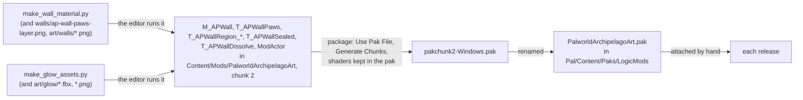

# PalworldArchipelagoUI (LogicMod)

An optional Blueprint pak that gives the Archipelago Mailbox its own window:
- one row per item; pick a row to take that item into your bag;
- Take all and Close buttons;
- mouse, keyboard and controller all work.

Without it, the Lua mod shows the mailbox in the game's own chest window, which works on its own. The pak holds only
layout. All logic stays in the Lua mod (`Scripts/mailbox.lua`), so the pak rarely needs rebuilding.

It is built in the community Palworld Modding Kit (Unreal Engine 5.1) on Windows. A Linux machine can't build it: the
kit needs Windows tools.

## What the Lua mod expects (keep these names exactly)

| Asset (`/Game/Mods/PalworldArchipelagoUI/`) | Parent | Widgets (each ticked **Is Variable**) | Graph |
|---|---|---|---|
| `ModActor` | Actor | none | none |
| `WBP_APButton` | User Widget | `Btn` (Button), `Icon` (Image), `Label` (Text) | custom event `AP_Clicked`, called from Btn's On Clicked |
| `WBP_APMailbox` | PalUserWidgetOverlayUI | `Title`, `Summary` (Text), `List` (Scroll Box), `TakeAll`, `Close` (WBP_APButton) | none |

The pak file must be named `PalworldArchipelagoUI.pak`, the same as the folder.

How the Lua mod uses it:
- It opens the window through the game's HUD and fills `List` with WBP_APButton rows.
- It hooks `WBP_APButton_C:AP_Clicked` to learn which row or button was pressed.
- If a name above is missing, UE4SS.log says `mailbox: the LogicMod window has no widget named ...`.

## Part 1: one-time PC setup (about 1 to 2 hours, mostly downloads)

1. Install the **Epic Games Launcher**, sign in, and install **Unreal Engine 5.1** (Library > Engine Versions > +).
2. Install **Visual Studio 2022** with the "Game development with C++" workload, plus the individual component
   **MSVC v143 - VS 2022 C++ x64/x86 build tools (v14.38)**.
3. Install the **.NET 6 SDK**.
4. Install the **Audiokinetic Launcher** (needs a free Audiokinetic account). Through it, install
   **Wwise 2021.1.11.7933** with the SDK, and download the offline integration files for Unreal.
5. Clone the kit next to a short path: `git clone https://github.com/localcc/PalworldModdingKit C:\PMK`.
6. Put Wwise into the kit:
   1. Unpack `Unreal.5.0.tar.xz` from the Wwise offline files. It may hold a second `.tar` to unpack.
   2. Copy the unpacked `Wwise` folder to `C:\PMK\Plugins\Wwise`.
   3. Make `C:\PMK\Plugins\Wwise\ThirdParty`.
   4. Copy `Win32_vc170`, `x64_vc170` and `include` into it from
      `C:\Program Files (x86)\Audiokinetic\Wwise 2021.1.11.7933\SDK`.
   5. Copy `Win32_vc170` and `x64_vc170` again, naming the copies `Win32_vc160` and `x64_vc160`.
   6. In `C:\PMK\Plugins\Wwise\Wwise.uplugin`, change `"EngineVersion" : "5.0.0"` to `"EngineVersion" : "5.1"`.
7. Start Unreal Engine 5.1 once and close it. Then edit
   `%APPDATA%\Unreal Engine\UnrealBuildTool\BuildConfiguration.xml`:
   - under `VCProjectFileGenerator`: `<Version>VisualStudio2022</Version>`;
   - under `WindowsPlatform`: `<Compiler>VisualStudio2022</Compiler>` and
     `<CompilerVersion>14.38.33130</CompilerVersion>`. Leave out `ToolchainVersion`: UE 5.1 has no such setting and
     fails to read the file with it. Without it the build uses the 14.38 toolchain.
8. Double-click `C:\PMK\Pal.uproject`.
   - Answer **Yes** to "modules are out of date". The first compile takes a while.
   - Answer **Yes** to any Wwise compatibility prompt, and close any Wwise project-path popup.
   - Once the editor is up, let shaders finish, close it and open it once more.

Steps 1, 2 and 4 need your sign-ins.

## Part 2: make the assets (a minute)

In the kit's editor, choose **Tools > Execute Python Script...** and pick `logicmod\make_assets.py` from this repo.

Or run it with the editor closed, from a Command Prompt:

```
"C:\Program Files\Epic Games\UE_5.1\Engine\Binaries\Win64\UnrealEditor-Cmd.exe" C:\PMK\Pal.uproject ^
  -run=pythonscript -script="<repo>\logicmod\make_assets.py"
```

What it does:
- It makes the folder `Content/Mods/PalworldArchipelagoUI`, the three Blueprints and the chunk label (chunk 1, always
  cooked).
- It ticks the window's **Is Enable Cancel Action**, so Esc or a controller's B closes it.
- The Output Log lists each step with a `[PalworldArchipelagoUI]` prefix.

## Part 3: by hand in the editor (about 15 minutes)

Unreal's Python can't lay out widgets or add graph nodes, so these steps are manual. After renaming a widget, tick
**Is Variable** at the top of its Details panel. Text widgets start with it off.

**WBP_APButton** (one row of the list, and the two buttons at the bottom):
1. Open it. From the Palette, drag a **Button** into the Hierarchy and rename it `Btn`.
2. Drag a **Horizontal Box** onto `Btn`.
3. Drag an **Image** into the Horizontal Box and rename it `Icon`.
   - Brush > Image Size: 40 x 40.
   - Visibility: Collapsed. The mod shows it when it has an icon.
   - Slot padding: right 12, vertical alignment centre.
4. Drag a **Text** into the Horizontal Box and rename it `Label`.
   - Font size 20, vertical alignment centre.
   - Slot Size: Fill.
5. Open the **Graph** tab. Right-click > **Add Custom Event** and name it `AP_Clicked`. Leave it with nothing connected.
6. Back in **Designer**, select `Btn`, and under Details > Events click **+** next to **On Clicked**.
7. From that new node's white output pin, drag out, type `AP_Clicked` and choose the function call.
8. **Compile**, then **Save**.

**WBP_APMailbox** (the window):
1. Open it. Drag a **Canvas Panel** into the Hierarchy as its root.
2. Drag a **Border** into the Canvas Panel. In its Slot:
   - Anchors: centre;
   - Alignment: 0.5, 0.5;
   - Position: 0, 0;
   - Size: 760 x 620.
   Set Brush Color to a dark blue-grey at about 90% alpha, and Padding to 24.
3. Drag a **Vertical Box** into the Border. Into the Vertical Box, in this order:
   1. a **Text** named `Title`, font size 28;
   2. a **Text** named `Summary`, font size 16, Auto Wrap Text on, slot padding bottom 12;
   3. a **Scroll Box** named `List`, slot Size Fill;
   4. a **Horizontal Box**, slot padding top 12 and horizontal alignment right.
4. From the Palette's **User Created** section, drag two **WBP_APButton** into that Horizontal Box. Name them
   `TakeAll` and `Close`, and give `Close` a left padding of 12.
5. Check that `Title`, `Summary`, `List`, `TakeAll` and `Close` all have **Is Variable** ticked.
6. In **Class Defaults**, check that **Is Enable Cancel Action** is ticked. Part 2 sets it; tick it if not.
7. **Compile**, then **Save**.

## Part 4: package and install

1. Open **Edit > Project Settings > Packaging** and turn on **Use Pak File** and **Generate Chunks**.
2. Choose **Platforms > Windows > Package Project** and pick an output folder, for example
   `C:\AI\CLAUDE\palworld-logicmod\out`.
3. In `out\Windows\Pal\Content\Paks\`, take `pakchunk1-Windows.pak`. If `pakchunk1-Windows.ucas` and `.utoc` sit
   beside it, take those too.
4. Rename them to `PalworldArchipelagoUI.pak` (and `.ucas` / `.utoc`).
5. Copy them to
   `C:\Program Files (x86)\Steam\steamapps\common\Palworld\Pal\Content\Paks\LogicMods\`.
   Make the `LogicMods` folder if it isn't there.
6. Make sure `BPModLoaderMod` is enabled in `ue4ss\Mods\mods.txt`. UE4SS ships it on.
7. In game, open Esc > **Archipelago Mailbox**. UE4SS.log should say `mailbox: window open`. If it says
   `chest view open` instead, the pak wasn't found.

To go back to the chest window without removing the pak, set `mailbox_view=chest` in the mod's `config.txt`.

## Later, only if needed

- **Giving Pals:** no Lua route works. Two crash the game (drop and pick up, and the character manager: UE4SS
  can't pass a Pal's save parameter struct from Lua); the captured cage makes a Pal handle but never a Pal in the
  world, so nothing can be captured. The C++ connector has a try at it: `AP_GivePal`
  (cppmod/APConnector/src/pal_gift.cpp) builds the save data and calls `CreateIndividual` with the party's own
  callback bound, or imports the Pal into the Palbox, in heap memory of the right size. **It is untested in game**;
  `test_tools=1` gives one hotkey per route (Ctrl+1 to Ctrl+5, see `Scripts/test_tools.lua`). Like the game's own
  create, it works only where the game has authority: single player or a listen-server host, not a client of a
  dedicated server. A Blueprint function here remains the fallback if every route fails: it can build the save
  parameter itself and call `CreateIndividual` with a real callback.
- **Wall look:** done as its own pak; see "The wall material" below.

## The wall material and the glows (PalworldArchipelagoArt.pak)

A second, separate pak. It holds `M_APWall`, for multicoloured area walls (the game's wall material shows one colour
per wall piece; this one shows a full-colour picture), and the glows' meshes, textures and `M_APGlow` material (the
check glow round fast-travel statues still to check, and the burst round the player when an item arrives). It is
independent of the mailbox window: it needs only Part 1's setup, not Parts 2 and 3.



1. Run both scripts, one after the other, the same way as Part 2 (Tools > Execute Python Script..., or with the
   editor closed, from a Command Prompt):

   ```
   "C:\Program Files\Epic Games\UE_5.1\Engine\Binaries\Win64\UnrealEditor-Cmd.exe" C:\PMK\Pal.uproject ^
     -run=pythonscript -script="<repo>\logicmod\make_wall_material.py"
   "C:\Program Files\Epic Games\UE_5.1\Engine\Binaries\Win64\UnrealEditor-Cmd.exe" C:\PMK\Pal.uproject ^
     -run=pythonscript -script="<repo>\logicmod\make_glow_assets.py"
   ```

   `make_wall_material.py` builds `M_APWall`, `ModActor` and the chunk label (chunk 2), which takes everything in
   the folder. `make_glow_assets.py` imports the six glow meshes and six textures from `logicmod\art\glow\` and
   builds `M_APGlow`; a file missing there is skipped with a log line. Nothing is by hand. Every Output Log line
   starts with `[PalworldArchipelagoArt]`; check for `LogPython: Error`.
2. Optional check: open `Content/Mods/PalworldArchipelagoArt/M_APWall` and `M_APGlow` and look for a compile error
   at the bottom.
3. Package as in Part 4 (Use Pak File and Generate Chunks on), and also, in `Config\DefaultGame.ini` under
   `[/Script/UnrealEd.ProjectPackagingSettings]`, `bShareMaterialShaderCode=False` (and
   `bSharedMaterialNativeLibraries=False`), so the material's compiled shaders go in its own pak, not in a shared
   shader library in chunk 0, which is never installed. (Without them the pak comes out at about 33 KB, too small
   to hold the shaders.) The script also makes an empty `ModActor`, so BPModLoader's log says whether the game loaded
   the pak. Take `pakchunk2-Windows.pak` (and `.ucas` / `.utoc` if there), rename to `PalworldArchipelagoArt.pak`
   (and `.ucas` / `.utoc`), and copy to `Pal\Content\Paks\LogicMods\`.
4. In game, the walls wear the default `regions` skin. UE4SS.log says `wall skin region:<region>-<version>:<colour>:
   material made on M_APWall`. A pak built before the region walls makes it say `wall skin regions: the
   PalworldArchipelagoArt pak has no region walls (or is not there); paws instead`, and the walls wear the cream paws
   (`wall skin paws:<colour>: material made on M_APWall`). Without the pak it also says `wall skin paws: needs the
   PalworldArchipelagoArt pak` and the walls wear the area colours instead.
   For the glows it says `glow: the pak's glow meshes, textures and M_APGlow found`, or without them
   `glow: off for this session: the PalworldArchipelagoArt pak has no ...`.
5. For a release: attach the same files to the draft release CI made from the version tag, before publishing it
   (the drafted notes remind you; the setup guide sends players there for the pak).

What the Lua mod sets on `M_APWall`: `Pattern` (a region's wall in the default `regions` skin, the cream-paw layer in the
`paws` skin), and optionally `Back`/`BackAlpha` (a colour under the pattern; both skins put the region's colour at
0.34, and the regions skin a dark red-grey at 0.55 under the bunker grille of a lock beyond the goal), `CellSize` (cm
per tile, 300), `ScrollU`/`ScrollV`, `Tint`, `Brightness`, `Opacity`, `FadeStart`/`FadeEnd` (1500 / 2500 cm),
`OffsetU`/`OffsetV`/`MirrorU` (each of the 75 Areas a variant of its Region's look), and `DissolveStart`/`DissolveTime`
(an unlock: the wall dissolves by the game's clock). It also glows and ripples near the player, whose position the mod
sets as `PlayerPos` each update (300 ms) (`ReactRadius`, `ReactStrength`, `RippleSize`, `RippleSpeed`, `ReactColor`).
The material also has `NightDim`, a multiplier on the brightness for dimming the walls at night; the mod does not
set it, so it stays 1.
The script also cooks, with mips, `walls\ap-wall-paws-layer.png` (in the Lua mod's folder) into the pak as
`T_APWallPaws`, and every region wall in `logicmod\art\walls` (see its README.txt): each of the 15 regions in four
versions as `T_APWallRegion_<region>_<version>` (the region's name in lower case, words joined by `_`, such as
`T_APWallRegion_bamboo_groves_0`), and the bunker grille as `T_APWallSealed`. The 15 regions wear version 0; with Lock
Size: areas each area wears the version `Scripts\wall_region_variants.lua` gives it. The Lua mod has no copy of the
region walls, so a pak built before them gives the paws. It reads the PNGs from this repo, so run it from a full
checkout. The pattern is laid on the wall in world space, so it keeps its size on every
piece and recedes in perspective.

What the Lua mod sets on `M_APGlow` (`glow_pieces.lua`; the full list is at the top of `make_glow_assets.py`): `Tex`
(a colour picture) or `Mask` (a light mask), `Tint`, `Brightness`, `EdgePower` (soft edges), `Spin` (turns a second,
the halo), `StartTime`, `Life`, `FadeDelay` and `FadePower` (a fade by the game's clock, as `M_APWall`'s dissolve),
`GrowXY`, `GrowZ` and `GrowTime` (the burst's shock ring and column grow in the material, smooth between the mod's
300 ms updates), and `NearFadeStart`/`NearFadeEnd` (the pillar hides up close). The glows are on by default;
`glow=0` in the mod's `config.txt` turns them off. The glows are untested in game.
