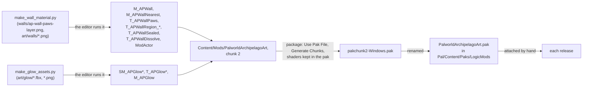

# The LogicMod paks

Two Unreal paks hold what the Lua mod cannot make itself. Both are built in the community Palworld Modding Kit
(Unreal Engine 5.1) on Windows; a Linux machine can't build them, as the kit needs Windows tools. The Lua mod works
without either.

| Pak | Holds | Without it | Releases |
|---|---|---|---|
| `PalworldArchipelagoArt.pak` (the Art pak) | `M_APWall`, the walls' own material, with its textures (each region's wall, the cream paws, the sealed wall, the dissolve pattern); the glows' meshes, textures and `M_APGlow` material | the walls wear the region or area colours on the game's wall material, and there are no glows | attached to every release, by hand |
| `PalworldArchipelagoUI.pak` (the UI pak) | the Archipelago Mailbox's own window | the mailbox opens in the game's own chest window, which works on its own | not released yet |

Both go in `Pal\Content\Paks\LogicMods\` in the game's folder. This file: the one-time setup of the kit (Part 1),
then [the Art pak](#the-wall-material-and-the-glows-palworldarchipelagoartpak), then
[the UI pak](#the-mailbox-window-palworldarchipelagouipak).

## Part 1: one-time PC setup (about 1 to 2 hours, mostly downloads)

1. Install the **Epic Games Launcher**, sign in, and install **Unreal Engine 5.1** (Library > Engine Versions > +).
2. Install **Visual Studio 2022** with the "Game development with C++" workload, plus the individual component
   **MSVC v143 - VS 2022 C++ x64/x86 build tools (v14.38)**.
3. Install the **.NET 6 SDK**.
4. Install the **Audiokinetic Launcher** (needs a free Audiokinetic account). Through it, install
   **Wwise 2021.1.11.7933** with the SDK, and download the offline integration files for Unreal.
5. Clone the kit next to a short path: `git clone https://github.com/localcc/PalworldModdingKit C:\PMK`.
6. Put Wwise into the kit:
   1. Unpack `Unreal.5.0.tar.xz` from the Wwise offline files. It may hold a second `.tar` to unpack.
   2. Copy the unpacked `Wwise` folder to `C:\PMK\Plugins\Wwise`.
   3. Make `C:\PMK\Plugins\Wwise\ThirdParty`.
   4. Copy `Win32_vc170`, `x64_vc170` and `include` into it from
      `C:\Program Files (x86)\Audiokinetic\Wwise 2021.1.11.7933\SDK`.
   5. Copy `Win32_vc170` and `x64_vc170` again, naming the copies `Win32_vc160` and `x64_vc160`.
   6. In `C:\PMK\Plugins\Wwise\Wwise.uplugin`, change `"EngineVersion" : "5.0.0"` to `"EngineVersion" : "5.1"`.
7. Start Unreal Engine 5.1 once and close it. Then edit
   `%APPDATA%\Unreal Engine\UnrealBuildTool\BuildConfiguration.xml`:
   - under `VCProjectFileGenerator`: `<Version>VisualStudio2022</Version>`;
   - under `WindowsPlatform`: `<Compiler>VisualStudio2022</Compiler>` and
     `<CompilerVersion>14.38.33130</CompilerVersion>`. Leave out `ToolchainVersion`: UE 5.1 has no such setting and
     fails to read the file with it. Without it the build uses the 14.38 toolchain.
8. Double-click `C:\PMK\Pal.uproject`.
   - Answer **Yes** to "modules are out of date". The first compile takes a while.
   - Answer **Yes** to any Wwise compatibility prompt, and close any Wwise project-path popup.
   - Once the editor is up, let shaders finish, close it and open it once more.

Steps 1, 2 and 4 need your sign-ins.

Each pak's assets are made by a Python script from this repository. Run one inside the kit's editor with
**Tools > Execute Python Script...**, or with the editor closed, from a Command Prompt:

```
"C:\Program Files\Epic Games\UE_5.1\Engine\Binaries\Win64\UnrealEditor-Cmd.exe" C:\PMK\Pal.uproject ^
  -run=pythonscript -script="<repo>\logicmod\<script>.py"
```

## The wall material and the glows (PalworldArchipelagoArt.pak)

The Art pak holds `M_APWall`, for multicoloured walls (the game's wall material shows one colour per wall piece; this
one shows a full-colour picture), and the glows' meshes, textures and `M_APGlow` material (the check glow round
fast-travel statues still to check, and the burst round the player when an item arrives). It needs only Part 1's
setup.



1. Run both scripts, one after the other, as above: `make_wall_material.py`, then `make_glow_assets.py`.
   - `make_wall_material.py` builds `M_APWall`; `M_APWallNearest` (an experiment: if it fails, the Output Log says so
     and the pak goes without it); the textures `T_APWallPaws`, `T_APWallRegion_<region>_<version>`, `T_APWallSealed`
     and `T_APWallDissolve`; `ModActor`; and the chunk label (chunk 2), which takes everything in the folder.
   - `make_glow_assets.py` imports the six glow meshes and six textures from `logicmod\art\glow\` and builds
     `M_APGlow`; a file missing there is skipped with a log line.

   Nothing is by hand. Every Output Log line starts with `[PalworldArchipelagoArt]`; check for `LogPython: Error`.
2. Optional check: open `Content/Mods/PalworldArchipelagoArt/M_APWall` and `M_APGlow` and look for a compile error
   at the bottom.
3. Package:
   1. In `Config\DefaultGame.ini` under `[/Script/UnrealEd.ProjectPackagingSettings]`, set
      `bShareMaterialShaderCode=False` (and `bSharedMaterialNativeLibraries=False`), so the materials' compiled
      shaders go in their own pak, not in a shared shader library in chunk 0, which is never installed. (Without them
      the pak comes out at about 33 KB, too small to hold the shaders.)
   2. Open **Edit > Project Settings > Packaging** and turn on **Use Pak File** and **Generate Chunks**.
   3. Choose **Platforms > Windows > Package Project** and pick an output folder (`<out>` below).
   4. In `<out>\Windows\Pal\Content\Paks\`, take `pakchunk2-Windows.pak` (and `.ucas` / `.utoc` if there), rename
      them to `PalworldArchipelagoArt.pak` (and `.ucas` / `.utoc`), and copy them to `Pal\Content\Paks\LogicMods\`.
      Make the `LogicMods` folder if it isn't there. The empty `ModActor` makes BPModLoader's log say whether the
      game loaded the pak.
4. In game, the walls wear the default `regions` skin. UE4SS.log says `wall skin region:<region>-<version>:<colour>:
   material made on M_APWall`. A pak built before the region walls makes it say `wall skin regions: the
   PalworldArchipelagoArt pak has no region walls (or is not there); paws instead`, and the walls wear the cream paws
   (`wall skin paws:<colour>: material made on M_APWall`). Without the pak it also says `wall skin paws: needs the
   PalworldArchipelagoArt pak` and the walls wear the area colours instead.
   For the glows it says `glow: the pak's glow meshes, textures and M_APGlow found`, or without them
   `glow: off for this session: the PalworldArchipelagoArt pak has no ...`.
5. For a release: attach the same files to the draft release CI made from the version tag, before publishing it
   (the drafted notes remind you; the setup guide sends players there for the pak).

### M_APWall's parameters

The full list, with what each does, is at the top of `make_wall_material.py`.

Set by the Lua mod (`wall_skins.lua`):
- `Pattern`: the layer over the colour: a region's wall in the default `regions` skin, the cream paws in the `paws`
  skin.
- `Back` and `BackAlpha`: a colour under the pattern. Both skins put the region's colour at 0.34, and the regions skin
  a dark red-grey at 0.55 under the bunker grille of a lock beyond the goal.
- `Brightness`.
- `FadeStart` and `FadeEnd`: where the wall starts to fade from the camera and where it is gone (1500 and 2500 cm;
  `wall_fade` in config.txt changes them).
- `ScrollU` and `ScrollV`: only when `wall_scroll` is set in config.txt.
- `OffsetU`, `OffsetV` and `MirrorU`: with the 75 areas, so sister areas of one region differ.
- `DissolveStart` and `DissolveTime`: an unlock; the wall dissolves by the game's clock.
- `PlayerPos`: the player's position, each update (300 ms), for the glow and ripples near the player.

Left at the material's defaults (the mod never sets them): `CellSize` (cm per tile, 300), `Tint`, `Opacity`,
`NightDim` (a multiplier on the brightness for dimming the walls at night, 1), `ReactRadius`, `ReactStrength`,
`RippleSize`, `RippleSpeed`, `ReactColor` and `EdgeColor`.

The script also cooks, with mips, `walls\ap-wall-paws-layer.png` (in the Lua mod's folder) into the pak as
`T_APWallPaws`, and every region wall in `logicmod\art\walls` (see its README.txt): each of the 15 regions in four
versions as `T_APWallRegion_<region>_<version>` (the region's name in lower case, words joined by `_`, such as
`T_APWallRegion_bamboo_groves_0`), the bunker grille as `T_APWallSealed`, and the dissolve's embers pattern as
`T_APWallDissolve`. The 15 regions wear version 0; with Lock Size: areas each area wears the version
`Scripts\wall_region_variants.lua` gives it. The Lua mod has no copy of the region walls, so a pak built before them
gives the paws. The script reads the PNGs from this repository, so run it from a full checkout. The pattern is laid
on the wall in world space, so it keeps its size on every piece and recedes in perspective.

### M_APGlow's parameters

What the Lua mod sets on `M_APGlow` (`glow_pieces.lua`; the full list is at the top of `make_glow_assets.py`): `Tex`
(a colour picture) or `Mask` (a light mask), `Tint`, `Brightness`, `EdgePower` (soft edges), `Spin` (turns a second,
the halo), `StartTime`, `Life`, `FadeDelay` and `FadePower` (a fade by the game's clock, as `M_APWall`'s dissolve),
`GrowXY`, `GrowZ` and `GrowTime` (the burst's shock ring and column grow in the material, smooth between the mod's
300 ms updates), and `NearFadeStart`/`NearFadeEnd` (the pillar hides up close). The glows are on by default;
`glow=0` in the mod's `config.txt` turns them off. The glows are untested in game.

## The mailbox window (PalworldArchipelagoUI.pak)

An optional Blueprint pak that gives the Archipelago Mailbox its own window:
- one row per item; pick a row to take that item into your bag;
- Take all and Close buttons;
- mouse, keyboard and controller all work.

The pak holds only layout. All logic stays in the Lua mod (`Scripts/mailbox.lua`, and `Scripts/mailbox_window.lua`,
which fills the window and answers its buttons), so the pak rarely needs rebuilding.

### What the Lua mod expects (keep these names exactly)

| Asset (`/Game/Mods/PalworldArchipelagoUI/`) | Parent | Widgets (each ticked **Is Variable**) | Graph |
|---|---|---|---|
| `ModActor` | Actor | none | none |
| `WBP_APButton` | User Widget | `Btn` (Button), `Icon` (Image), `Label` (Text) | custom event `AP_Clicked`, called from Btn's On Clicked |
| `WBP_APMailbox` | PalUserWidgetOverlayUI | `Title`, `Summary` (Text), `List` (Scroll Box), `TakeAll`, `Close` (WBP_APButton) | none |

The pak file must be named `PalworldArchipelagoUI.pak`, the same as the folder.

How the Lua mod uses it:
- It opens the window through the game's HUD and fills `List` with WBP_APButton rows.
- It hooks `WBP_APButton_C:AP_Clicked` to learn which row or button was pressed.
- If a name above is missing, UE4SS.log says `mailbox: the LogicMod window has no widget named ...`.

### Part 2: make the assets (a minute)

Run `logicmod\make_assets.py` from this repository, as under Part 1 (Tools > Execute Python Script..., or the
Command Prompt line with `make_assets.py`).

What it does:
- It makes the folder `Content/Mods/PalworldArchipelagoUI`, the three Blueprints and the chunk label (chunk 1, always
  cooked).
- It ticks the window's **Is Enable Cancel Action**, so Esc or a controller's B closes it.
- The Output Log lists each step with a `[PalworldArchipelagoUI]` prefix.

### Part 3: by hand in the editor (about 15 minutes)

Unreal's Python can't lay out widgets or add graph nodes, so these steps are manual. After renaming a widget, tick
**Is Variable** at the top of its Details panel. Text widgets start with it off.

**WBP_APButton** (one row of the list, and the two buttons at the bottom):
1. Open it. From the Palette, drag a **Button** into the Hierarchy and rename it `Btn`.
2. Drag a **Horizontal Box** onto `Btn`.
3. Drag an **Image** into the Horizontal Box and rename it `Icon`.
   - Brush > Image Size: 40 x 40.
   - Visibility: Collapsed. The mod shows it when it has an icon.
   - Slot padding: right 12, vertical alignment centre.
4. Drag a **Text** into the Horizontal Box and rename it `Label`.
   - Font size 20, vertical alignment centre.
   - Slot Size: Fill.
5. Open the **Graph** tab. Right-click > **Add Custom Event** and name it `AP_Clicked`. Leave it with nothing connected.
6. Back in **Designer**, select `Btn`, and under Details > Events click **+** next to **On Clicked**.
7. From that new node's white output pin, drag out, type `AP_Clicked` and choose the function call.
8. **Compile**, then **Save**.

**WBP_APMailbox** (the window):
1. Open it. Drag a **Canvas Panel** into the Hierarchy as its root.
2. Drag a **Border** into the Canvas Panel. In its Slot:
   - Anchors: centre;
   - Alignment: 0.5, 0.5;
   - Position: 0, 0;
   - Size: 760 x 620.
   Set Brush Color to a dark blue-grey at about 90% alpha, and Padding to 24.
3. Drag a **Vertical Box** into the Border. Into the Vertical Box, in this order:
   1. a **Text** named `Title`, font size 28;
   2. a **Text** named `Summary`, font size 16, Auto Wrap Text on, slot padding bottom 12;
   3. a **Scroll Box** named `List`, slot Size Fill;
   4. a **Horizontal Box**, slot padding top 12 and horizontal alignment right.
4. From the Palette's **User Created** section, drag two **WBP_APButton** into that Horizontal Box. Name them
   `TakeAll` and `Close`, and give `Close` a left padding of 12.
5. Check that `Title`, `Summary`, `List`, `TakeAll` and `Close` all have **Is Variable** ticked.
6. In **Class Defaults**, check that **Is Enable Cancel Action** is ticked. Part 2 sets it; tick it if not.
7. **Compile**, then **Save**.

### Part 4: package and install

1. Open **Edit > Project Settings > Packaging** and turn on **Use Pak File** and **Generate Chunks**.
2. Choose **Platforms > Windows > Package Project** and pick an output folder (`<out>` below).
3. In `<out>\Windows\Pal\Content\Paks\`, take `pakchunk1-Windows.pak`. If `pakchunk1-Windows.ucas` and `.utoc` sit
   beside it, take those too.
4. Rename them to `PalworldArchipelagoUI.pak` (and `.ucas` / `.utoc`).
5. Copy them to
   `C:\Program Files (x86)\Steam\steamapps\common\Palworld\Pal\Content\Paks\LogicMods\`.
   Make the `LogicMods` folder if it isn't there.
6. Make sure `BPModLoaderMod` is enabled in `ue4ss\Mods\mods.txt`. UE4SS ships it on.
7. In game, open Esc > **Archipelago Mailbox**. UE4SS.log should say `mailbox: window open`. If it says
   `chest view open` instead, the pak wasn't found.

To go back to the chest window without removing the pak, set `mailbox_view=chest` in the mod's `config.txt`.

## Test keys

`test_tools=1` in the mod's `config.txt` turns on the test tools; their keys (among them one per Pal-gift route of
the C++ connector) are listed in the header of `mod/PalworldArchipelago/Scripts/test_tools.lua`. Why Pals are given
from C++ and not from a pak or Lua is under the APConnector in [the architecture guide](../docs/architecture.md).
